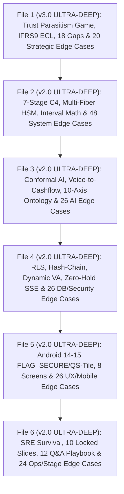

# MASTER ROADMAP & ULTRA-DEEP SPECIFICATION INDEX — VayShield AI (6/6 Ultra-Deep Locked)

**Trạng thái Toàn Dự Án:** **HOÀN TẤT 100% CHU TRÌNH NÂNG CẤP CHIỀU SÂU TỐI ĐA (6/6 ULTRA-DEEP SPECIFICATIONS + 170 EDGE CASES)**  
**Tổng hợp Quy mô Phân tích:** **18** Lỗ hổng Bản Draft (`G01–G18`) • **6** Giả thuyết Khoa học ($H_1 \to H_6$) • **6** Lớp Hào lũy Chống Dịch ngược & Chống Chia sẻ Màn hình • **4** Tầng Hạ cấp Sống còn (Graceful Fallbacks) • **12** Kịch bản Phản biện Giám khảo • **170 Edge Cases Thực chiến Trực giao** trải rộng trên cả 6 tầng kiến trúc!

---

## Sơ Đồ Tổng Thể Bộ 6 Văn Kiện Kiến Trúc Ultra-Deep

---

## Bảng Chỉ Mục Toàn Bộ 6 Tài Liệu Đặc Tả Kỹ Thuật Chính Thức

| Phiên | Tài Liệu Chính Thức (Ultra-Deep) | Các Tầng Kiến Trúc Phức Tạp & Số Lượng Edge Cases Đã Hóa Giải | Trạng Thái |
| :--- | :--- | :--- | :---: |
| **File 1 (v3.0)** | [session_01_audit_and_product_strategy.md](file:///C:/Users/Anh%20Kiet/Downloads/momo/session_01_audit_and_product_strategy.md) | • Trò chơi Ký sinh Tín nhiệm ($\Gamma_{\text{parasite}}$), Kinh tế lượng Rủi ro Ngân hàng IFRS 9 ($\Delta\text{ECL}$) • Khung Pháp lý 7 phân khúc (Cầm cố, Ví trả sau BNPL Cash-out, Đứng tên vay hộ, Cắt phế hàng hóa) • 6 Giả thuyết Khoa học, 6 Lớp Hào lũy + Phác đồ Cấp cứu Giờ Vàng sau mất tiền • **18 Lỗ hổng Draft (`G01..18`) + 20 Edge Cases Chiến lược/Pháp lý/Hành vi (`EC-S01..20`)** | **HOÀN TẤT v3.0** |
| **File 2 (v2.0)** | [session_02_system_architecture_and_financial_engine.md](file:///C:/Users/Anh%20Kiet/Downloads/momo/session_02_system_architecture_and_financial_engine.md) | • Đường ống 7 chặng `Neuro-Symbolic Risk Kernel` & Bất biến Đồng hồ Đơn điệu chống tua giờ • Giám sát Đa phiên vay `Multi-Fiber Semilattice HSM`, phát hiện `MediaProjection` & `S9_GOLDEN_HOUR_TRIAGE` • Toán học Khoảng nhạy (`[APR_min, APR_max]`), Lãi 2 pha, MIRR, Cắt phế hàng hóa & Ma trận 9 phán quyết • **48 Edge Cases Hệ thống - Viễn thông - Thanh toán - Toán học - Phân tán (`01..48`)** | **HOÀN TẤT v2.0** |
| **File 3 (v2.0)** | [session_03_neuro_symbolic_ai_and_dataset.md](file:///C:/Users/Anh%20Kiet/Downloads/momo/session_03_neuro_symbolic_ai_and_dataset.md) | • Định tuyến hiệu chỉnh xác suất `Split Conformal Prediction` & `Voice-to-Cashflow` xử lý tiếng lóng • Giám định biên lai giả (`ELA`), khử con dấu đỏ HSV & phân định mã VietQR theo bong bóng chat Trái/Phải • Bản thể học 10 Trục Thao túng (`C1–C10`), Huber-Medoid chống đầu độc Vector & `VayShield-Bench-340` • **26 Edge Cases chuyên sâu của AI Thị giác, Ngôn ngữ, Âm thanh & GraphRAG (`EC-AI01..26`)** | **HOÀN TẤT v2.0** |
| **File 4 (v2.0)** | [session_04_database_api_and_security_spec.md](file:///C:/Users/Anh%20Kiet/Downloads/momo/session_04_database_api_and_security_spec.md) | • SQL DDL đồng bộ 9 mã phán quyết, `fiber_key`, `Dynamic VA Prefix`, `Row-Level Security` & Chuỗi băm `Hash-Chain` • `Zero-Idle-Connection SSE` chống nghẽn DB Pool, Xoay vòng khóa `Dual-Pepper` & Endpoints Giải cứu 2 chiều • **26 Edge Cases chuyên sâu của CSDL, Đồ thị, Mật mã, API & Phân tán (`EC-DB01..26`)** | **HOÀN TẤT v2.0** |
| **File 5 (v3.0)** | [session_05_android_uiux_and_frontend_spec.md](file:///C:/Users/Anh%20Kiet/Downloads/momo/session_05_android_uiux_and_frontend_spec.md) | • **Production-First + Stripe-style `Sandbox Mode`** (Sản phẩm thật 100%, không dùng màn hình giả lập Demo) • **100% `v0.dev` + Thư viện Component có sẵn** (`Shadcn UI`, `@xyflow/react`, `Recharts`, `Scalar API`, `Compose Material 3` — 0% tự vẽ tay) • **26 Edge Cases chuyên sâu của Android OS, iOS PWA, Component UI & Trình duyệt (`EC-UX01..26`)** | **HOÀN TẤT v3.0** |
| **File 6 (v2.1)** | [session_06_devops_qa_and_championship_pitch.md](file:///C:/Users/Anh%20Kiet/Downloads/momo/session_06_devops_qa_and_championship_pitch.md) | • 7 Kỹ thuật SRE sinh tồn (`Port 443`, `VIP Quota`, `prodHardened vs stageProjection`, chống lỗi `CRLF` & thu hồi khóa) • Bộ 10 Slide Chung kết (bản khóa), Video `02:52`, Mẫu Tờ A4 + `README.md` (chuẩn Sản phẩm Thật + `Sandbox Mode`) & **12 Câu hỏi Phản biện** • **24 Edge Cases chuyên sâu của DevOps, Quy chế Nộp bài & Khủng hoảng Sân khấu (`EC-OPS01..24`)** | **HOÀN TẤT v2.1** |
| **Phân Công 2 Nhóm** | [team_division_2_groups.md](file:///C:/Users/Anh%20Kiet/Downloads/momo/team_division_2_groups.md) | • **Chia đôi khối lượng 50% – 50%** không đụng code (`Zero Merge Conflict`), chạy song song ngay từ giờ thứ 2 • **24 Work Packages** (`WP1-01..12` & `WP2-01..12`) ánh xạ trực tiếp tới từng mục của 6 File Đặc tả • Lộ trình ghép nối 5 cột mốc (`M0 -> M4`), Gói công việc di động (`Swing Tasks`) & Phương án chia dọc thay thế | **SẴN SÀNG CHẠY** |

