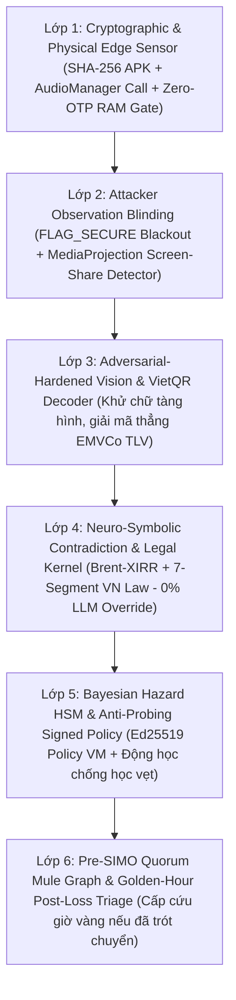

# SESSION 1 (v3.0 Ultra-Deep Edition) — Nền Tảng Khoa Học, Kinh Tế Lượng, Lý Thuyết Trò Chơi Động, Phản Biện 18 Lỗ Hổng & 20 Edge Cases Chiến Lược

**Dự án:** **VayShield AI** — Hệ sinh thái Phòng vệ Tín dụng Số Chủ động (Neuro-Symbolic Borrower Guardian & Fintech Fraud Ops Workspace)  
**Cuộc thi:** Imagine the Future Workspace (*Human Centered. AI Powered*)  
**Phương pháp luận áp dụng:** Computational Thinking • Kinh tế học Hành vi (Behavioral Economics) • Lý thuyết Trò chơi Động Bất đối xứng & Ký sinh Tín nhiệm (Dynamic Trust Parasitism Game) • Kinh tế lượng Rủi ro Tín dụng (IFRS 9 Expected Credit Loss) • Phương pháp Nghiên cứu Khoa học (Falsifiable Hypotheses) • Defense-in-Depth Systems Engineering.

---

## 1. Giải Phẫu Gốc Rễ Bài Toán Dưới Góc Nhìn Kinh Tế Học Hành Vi, Lý Thuyết Trò Chơi Động & Kinh Tế Lượng Ngân Hàng

Một sản phẩm đạt chuẩn Giải Nhất và sẵn sàng triển khai cấp ngân hàng không chỉ mô tả hiện tượng *"người dùng bị lừa"*, mà phải chứng minh bằng mô hình toán học - kinh tế **tại sao các biện pháp tuyên truyền và danh sách đen tĩnh hiện tại thất bại mang tính cấu trúc**, đồng thời chứng minh **động lực kinh tế định lượng để các tổ chức Fintech trả tiền tích hợp ngay hôm nay**.

### 1.1. Bốn Cơ Chế Thất Bại Thị Trường, Nhận Thức & Ký Sinh Tín Nhiệm

#### (A) Chiết khấu Hypebol & "Đường hầm Khan hiếm" (Hyperbolic Discounting & Scarcity Tunneling)
Theo mô hình thiên kiến hiện tại ($\beta\text{-}\delta$ *Quasi-Hyperbolic Discounting* của Laibson) kết hợp lý thuyết *Scarcity* (Mullainathan & Shafir), hàm hữu dụng nhận thức của người lao động đang khủng hoảng tiền mặt (viện phí, học phí, tiền trọ đến hạn trong vài giờ) có dạng:

$$U_t(c_t, c_{t+k}) = u(c_t) + \beta \sum_{k=1}^{T} \delta^k u(c_{t+k}), \quad \text{với } 0 < \beta \ll 1$$

Khi áp lực thanh khoản cấp tính xảy ra, hệ số $\beta$ sụp đổ về gần $0$: giá trị của **10 triệu đồng nhận ngay trong 5 phút** ($u(c_t)$) lấn át hoàn toàn gánh nặng phải trả **14 triệu đồng sau 30 ngày** ($\beta \delta^{30} u(c_{t+30})$). Đồng thời, hiệu ứng *Scarcity Tunneling* chiếm dụng băng thông nhận thức (Cognitive Bandwidth), khiến người vay **không đủ năng lượng tâm lý để giải mã cấu trúc phí ẩn** (phí thẩm định, phí quản lý tài khoản, phí gia hạn).  
$\rightarrow$ **Hệ quả thiết kế UI/UX:** Không thể chỉ hiển thị con số trừu tượng `APR = 501%/năm` (đòi hỏi tư duy Hệ thống 2 của Kahneman). Bắt buộc phải chuyển đổi tức thì sang **Đơn vị Đau đớn Hữu hình của Hệ thống 1**: *"Cầm 8,5 triệu hôm nay $\rightarrow$ Mất đứt 3,5 triệu tiền phí & lãi sau 30 ngày = Mất không 13,5 ngày công tăng ca"*.

#### (B) Ngụy biện Chi phí Chìm & Leo thang Cam kết (Sunk Cost Fallacy — Bẫy 1)
Trong kịch bản lừa phí trước giải ngân, kẻ gian không bao giờ đòi 20 triệu ngay lập tức. Chúng thiết kế chuỗi leo thang vi mô:
1. Bước 1: Đóng `300.000 VND` "phí hồ sơ bảo hiểm" để nhận `20.000.000 VND`.
2. Bước 2: Gửi biên lai giả báo *"Sai 1 chữ số tài khoản, khoản vay bị đóng băng trên hệ thống Liên ngân hàng"*, yêu cầu nộp `2.000.000 VND` "tiền đối ứng mở khóa" (cam kết hoàn lại toàn bộ `22.300.000 VND` sau 5 phút).
3. Bước 3: Đòi tiếp `10% thuế TNCN` hoặc `phí nâng điểm tín dụng CIC`.

Theo Hàm Giá trị trong **Lý thuyết Triển vọng (Prospect Theory — Kahneman & Tversky)**, con người sợ mất mát (Loss Aversion, $\lambda \approx 2.25$) mạnh gấp hơn 2 lần niềm vui nhận lợi ích:

$$v(x) = \begin{cases} x^\alpha & \text{nếu } x \ge 0 \\ -\lambda (-x)^\gamma & \text{nếu } x < 0 \end{cases}$$

Khi đã trót chuyển khoản đầu tiên, việc dừng lại đồng nghĩa với chấp nhận khoản lỗ chắc chắn $-L_1$. Kẻ gian lợi dụng tâm lý sợ mất $-L_1$ để ép nạn nhân chọn canh bạc rủi ro nộp thêm $L_2, L_3$ nhằm "cứu" cả gốc lẫn phí.  
$\rightarrow$ **Hệ quả thiết kế Rule Engine:** Bất kỳ giao dịch nào yêu cầu dòng tiền âm từ túi người đi vay trước thời điểm giải ngân ($\text{CF}_0 < 0$) phải bị cắt đứt ngay từ bước 1 bằng **Chốt chặn Cứng Tuyệt đối (Zero-Tolerance Hard Stop)**, tuyệt đối không hiển thị bảng so sánh lãi suất làm nạn nhân tưởng đây là khoản vay thật.

#### (C) Trò chơi Động Nhiều Giai đoạn & Cơ chế "Ký Sinh Tín Nhiệm" (Dynamic Game of Trust Parasitism — Bẫy 2 & Bẫy 3)
Xét trò chơi động 3 giai đoạn $\Gamma_{\text{parasite}} = \langle \{F, A, V\}, \mathcal{H}, \mu \rangle$ giữa Tổ chức Tín dụng Hợp pháp ($F$), Kẻ tấn công ($A$) và Người đi vay ($V$):
- **Ở Bẫy 1 & 2**: Chi phí để $A$ sao chép logo, con dấu đỏ, mã số thuế và giao diện hợp đồng của Home Credit / FE Credit là xấp xỉ bằng $0$ ($c_{\text{spoof}} \approx 0$), đẩy thị trường vào **Cân bằng Gộp (Pooling Equilibrium)** nếu chỉ xét văn bản tĩnh.
- **Ở Bẫy 3 (Đỉnh cao tinh vi — Ký sinh Tín nhiệm)**: Kẻ tấn công $A$ (thông qua trang web môi giới giả mạo hoặc hướng dẫn nạn nhân qua tính năng **Chia sẻ màn hình Zalo**) dẫn dắt $V$ nộp hồ sơ vay thật trên hệ thống của $F$. Khi $F$ giải ngân khoản tiền thật $+M$ vào tài khoản ngân hàng của $V$, chính giao dịch giải ngân thật của $F$ vô tình trở thành **Tín hiệu Đắt giá ($c_{\text{signal}} = M$)** mà $A$ ký sinh lên! Niềm tin hậu nghiệm Bayes của nạn nhân rằng người đang gọi điện đọc đúng số tiền $+M$ vừa về trong 3 phút là nhân viên thật của $F$ nhảy vọt lên:

$$\mu_V(\text{Caller} = F \mid \text{RealDisbursement } +M, \Delta t < 5\text{m}) = \frac{P(+M \mid F)\mu_0}{P(+M \mid F)\mu_0 + P(+M \mid A)(1-\mu_0)} \longrightarrow 0.98$$

$\rightarrow$ **Cách VayShield phá vỡ Cân bằng Gộp & Đảo Ngược Bất Đối Xứng Thông Tin:**
1. *Bất biến Mật mã & Nguồn gốc (Cryptographic Package Provenance)*: Chữ ký số SHA-256 của APK và nguồn cài đặt `com.android.vending` không thể bị kẻ gian giả mạo.
2. *Bất biến Nghiệp vụ Ngân hàng*: Tổ chức tín dụng hợp pháp thu hồi khoản vay lỗi qua hạch toán nội bộ/tất toán trên ứng dụng chính thức, **bất biến xác suất = 0%** việc gọi điện giục chuyển khoản sang tài khoản cá nhân hoặc "tài khoản kỹ thuật" bên ngoài.
3. *Bất biến Vật lý - Thời gian (Temporal-Acoustic Correlation)*: Kẻ gian buộc phải giữ kết nối thoại thời gian thực (`MODE_IN_CALL` / `MODE_IN_COMMUNICATION`) để điều khiển nạn nhân vượt qua bước xác thực sinh trắc học ngân hàng.
4. *Đảo ngược Bất đối xứng Quan sát bằng `FLAG_SECURE` (`Attacker Screen-Share Blinding`)*: Khi kẻ gian dụ nạn nhân bật **Chia sẻ màn hình Zalo / AnyDesk / TeamViewer** để giám sát thao tác, cửa sổ chặn của VayShield bật cờ phần cứng `WindowManager.LayoutParams.FLAG_SECURE` $\rightarrow$ Luồng hình ảnh truyền về máy kẻ gian lập tức **biến thành màu đen đặc 100%**, làm mù hoàn toàn kênh quan sát của kẻ tấn công trong suốt 15 giây khóa bình tĩnh!

#### (D) Mô hình Kinh tế lượng Rủi ro Tín dụng B2B Theo Chuẩn IFRS 9 ($\Delta\text{ECL}$ Unit Economics — Động lực Thương mại cho Fintech)
Dưới góc nhìn Giám đốc Quản trị Rủi ro (CRO) của một Công ty Tài chính Tiêu dùng hoặc Siêu ứng dụng Thanh toán, tổn thất tín dụng dự kiến tuân theo phương trình chuẩn **IFRS 9 / Basel**:

$$\text{ECL} = \text{PD} \times \text{LGD} \times \text{EAD}$$

- Với khoản vay tiêu dùng tiền mặt thông thường (`EAD = 20.000.000 VND`): Xác suất vỡ nợ cơ sở $\text{PD}_{\text{normal}} \approx 7.0\%$, tỷ lệ mất vốn sau thu hồi $\text{LGD}_{\text{normal}} \approx 75\% \implies \text{ECL}_{\text{normal}} \approx 1.050.000\text{ VND/khoản vay}$.
- Khi khách hàng sập **Bẫy số 3 (bị lừa mất sạch 20 triệu vừa giải ngân)**: Khách hàng vừa kiệt quệ tài chính thực sự, vừa mang tâm lý phẫn uất *"tôi bị lừa mất tiền sao công ty bắt tôi trả nợ"* $\implies$ Xác suất rơi vào nợ xấu Nhóm 5 nhảy vọt lên $\text{PD}_{\text{scammed}} \approx 92\%$, $\text{LGD}_{\text{scammed}} \approx 95\%$ (cộng thêm chi phí giải quyết khiếu nại CSKH/Pháp chế và khủng hoảng truyền thông mạo danh) $\implies \text{ECL}_{\text{scammed}} \approx 17.480.000\text{ VND/khoản vay}$ (tăng gấp **16,6 lần**!).
- **Bài toán ROI thực tế**: Chỉ cần $0.5\%$ tổng lượng giải ngân tiền mặt kênh số bị nhắm mục tiêu bởi Bẫy 3, trên quy mô `500.000 khoản vay/năm`, một công ty tài chính mất thêm **~41 tỷ đồng/năm** trích lập dự phòng rủi ro nợ xấu oan! Việc tích hợp `Post-Disbursement Shield API` của VayShield với chi phí chỉ vài nghìn đồng/lượt giải ngân mang lại tỷ suất hoàn vốn **$\text{ROI} > 25\times$**, biến an toàn của người dân thành lợi nhuận ròng trực tiếp cho doanh nghiệp Fintech.

---

### 1.2. Dữ Liệu Ngành & Khung Pháp Lý Mở Rộng 7 Phân Khúc Thực Chiến (2025–2026)

| Phân Khúc / Trụ Cột Pháp Lý | Quy Định Hiện Hành & Thực Tế Biến Tướng (Cập Nhật 2026) | Quy Tắc Xử Lý Chính Xác Trong Hệ Thống VayShield |
| :--- | :--- | :--- |
| **1. Lỗ hổng "Zero-Day Mule" của SIMO (NHNN)** | Tới Quý 3/2026, SIMO phát **>5,6 triệu cảnh báo**, giúp dừng **1,9 triệu giao dịch**, bảo vệ **6.300 – 7.200 tỷ đồng**. Tuy nhiên **~66% lượt nhận cảnh báo đơn thuần vẫn chuyển tiền** do bị thao túng qua điện thoại, và tài khoản mồi mới mở (`0 giờ tuổi`) chưa có trong SIMO. | Chặn bằng **Tương quan Hành vi Đầu cuối** trước khi cần biết STK đích, đồng thời đẩy băm STK mồi mới phát hiện về **Fintech Fraud Ops Workspace** để báo cáo sớm lên SIMO trong vài phút. |
| **2. Ngân hàng & 16 Công ty Tài chính Tiêu dùng Cấp phép** | Luật Các TCTD 2024 + TT 43/2016 + TT 18/2019/TT-NHNN: Lãi suất thỏa thuận quy đổi %/năm (365 ngày); **cấm gắn bảo hiểm không bắt buộc với việc cấp tín dụng** (Điều 15 Luật Các TCTD 2024). | Không báo "trái luật" khi lãi >20%; bóc tách minh bạch chi phí thật, nhắc quyền từ chối bảo hiểm tự nguyện kèm vay, và kiểm tra nghiêm ngặt **chống mạo danh thương hiệu**. |
| **3. Nền tảng P2P Lending Thử nghiệm (Sandbox)** | Nghị định 94/2025/NĐ-CP (hiệu lực 01/07/2025) & Quyết định 2866/QĐ-NHNN: Trần dư nợ tối đa **100 triệu đồng/khách/nền tảng** và **400 triệu đồng toàn hệ thống** kết nối CIC. | Kiểm tra giấy chứng nhận tham gia Sandbox NHNN VÀ kiểm tra số tiền chào vay có vượt hạn mức cứng 100 triệu đồng hay không. |
| **4. Cho vay Dân sự / App Tín dụng Đen Không Phép** | Điều 468 BLDS 2015 (Trần **20%/năm**) & Điều 201 BLHS 2015/2017 + Nghị quyết 01/2021/NQ-HĐTP (Lãi gộp phí trá hình **$\ge$ 100%/năm** = gấp 5 lần trần BLDS là dấu hiệu Tội cho vay lãi nặng). | Phân tách rạch ròi ngưỡng vượt trần dân sự (`20% – <100%/năm`) và ngưỡng nguy cơ hình sự tín dụng đen (`>= 100%/năm`). |
| **5. Cầm đồ Hợp pháp & Vay Cầm cố Đăng ký Xe máy** | Điều 309 BLDS + Nghị định 96/2016/NĐ-CP: Lãi vay cầm cố bị giới hạn trần 20%/năm, nhưng thực tế phát sinh *phí thẩm định điều kiện cho vay, phí quản lý/bảo quản tài sản cầm cố*. | Phân biệt **Hợp đồng Cầm cố Tài sản Thực tế tại Chuỗi Cấp phép** (tính tổng chi phí thực trả APR để người vay cân nhắc) với **App Tín dụng Đen Không Tài sản Bảo đảm Ngụy trang Phí Lưu kho Ảo**. |
| **6. Ví Trả Sau (BNPL) & Bẫy "Rút Tiền Mặt Ví Trả Sau"** | Các dịch vụ Mua trước trả sau hợp pháp (Ví Trả Sau trên siêu ứng dụng thanh toán) chỉ cho phép thanh toán hàng hóa/dịch vụ tại điểm chấp nhận thanh toán (Merchant), không cho rút tiền mặt. Tội phạm dụ quét QR Merchant khống *"rút tiền mặt phí 5%"* rồi chiếm đoạt 100% hạn mức! | Nhận diện mẫu tin nhắn/ảnh chat gạ gẫm *"rút tiền mặt Ví trả sau / đáo hạn hạn mức mua sắm qua mã QR"* ở Trạm 2 & Trạm 3 $\rightarrow$ Báo động Đỏ hành vi vi phạm quy định thanh toán & lừa đảo chiếm đoạt hạn mức. |
| **7. Bẫy "Đứng Tên Vay Hộ" & "Mua Trả Góp Bán Lại Cắt Phế"** | • *Đứng tên vay hộ*: Dụ sinh viên/công nhân ký eKYC vay 20–40 triệu hứa trả công 1–2 triệu *"công ty tự đóng lãi"* $\rightarrow$ Gánh nợ thật 100% trên CIC. • *Mua trả góp bán lại*: Ép ký hợp đồng mua iPhone trả góp 30 triệu rồi thu mua lại ngay tại quầy giá 20 triệu (lỗ tức thì 33%). | Bổ sung nhận diện mẫu kịch bản **Ủy thác Đứng tên Khoản vay (`Straw-Borrower Scam`)** và **Tín dụng Đen Ngụy trang Mua bán Hàng hóa (`Disguised Commodity Resale Usury`)**. |

---

## 2. Sáu Giả Thuyết Khoa Học Có Thể Kiểm Chứng (Falsifiable Scientific Hypotheses)

Toàn bộ thiết kế kiến trúc và giao thức kiểm định QA ở các Session tiếp theo được xây dựng để kiểm chứng định lượng 6 giả thuyết khoa học:

- **Giả thuyết $H_1$ (Độ chính xác Giải mã Hợp đồng Neuro-Symbolic):** Tách rời tầng *Trích xuất Thị giác có Cấu trúc* khỏi tầng *Giải phương trình Dòng tiền Tất định* giảm sai số tuyệt đối trung bình (MAE) khi tính lãi suất năm từ **$>35\%$** (LLM tự tính nhẩm) xuống **$<0.01\%$** trên mọi hợp đồng trích xuất đúng tham số, và đạt Recall phát hiện phí ứng trước **$\ge 99.0\%$**.
- **Giả thuyết $H_2$ (Tín hiệu Tương quan Vật lý Trạm 3):** Tổ hợp trạng thái không xâm phạm quyền riêng tư $\mathcal{S} = (\text{DisbursementWindow}_{24h}, \text{AudioMode} \in \{\text{IN\_CALL}, \text{IN\_COMM}\}, \text{ForegroundPkg} \in \mathcal{B}_{\text{bank}})$ phân biệt giao dịch bị thao túng sau giải ngân với giao dịch đời thường với **Precision $\ge 92\%$**, **Recall $\ge 96\%$**, độ trễ kích hoạt cục bộ **$<300\text{ms}$** kể cả khi mất mạng 4G.
- **Giả thuyết $H_3$ (Giảm Ma sát Nhận thức & Phá Vỡ "Mớm lời"):** Giao diện kết hợp *Giọng nói Tiếng Việt khẩn cấp (TTS)* + *Khóa bình tĩnh 15 giây* + *Giao thức hỏi đáp bất đối xứng không đối đầu* + *Thẻ giải cứu 2 chiều từ người thân* đạt tỷ lệ chặn thành công vượt trội so với cảnh báo văn bản tĩnh có nút "Đóng".
- **Giả thuyết $H_4$ (Rút ngắn Độ trễ Tình báo Gian lận Trước SIMO):** Tổng hợp ẩn danh tài khoản nhận tiền nghi vấn từ Trạm 2 & Trạm 3 về **Fintech Fraud Ops Workspace** cho phép phát hiện cụm *"tài khoản kỹ thuật"* mới sau **$k \ge 2$ thiết bị độc lập** trong vòng **$<60\text{ giây}$**.
- **Giả thuyết $H_5$ (Kháng Giám sát Chia sẻ Màn hình Đối kháng):** Kết hợp phát hiện thông báo `FOREGROUND_SERVICE_MEDIA_PROJECTION` (Zalo/TeamViewer/AnyDesk đang chiếu màn hình) với cờ phần cứng `FLAG_SECURE` trên màn hình can thiệp giúp triệt tiêu **100%** khả năng kẻ gian nhìn trộm câu hỏi đối chứng để chỉ đạo nạn nhân bấm vượt rào.
- **Giả thuyết $H_6$ (Hiệu quả Kinh tế Rủi ro Tín dụng B2B):** Kích hoạt chủ động Khiên 24h qua Webhook ngay thời điểm giải ngân giúp cắt giảm tỷ lệ chuyển hóa thành nợ xấu Nhóm 5 do lừa đảo sau giải ngân ($\Delta\text{ECL} > 0$), tạo giá trị ròng dương vượt xa chi phí gọi API.

---

## 3. Sáu Lớp Hào Lũy Kỹ Thuật & Hiến Chương Độc Lập Kiểm Toán (6-Layer Hard-to-Decode Moat)

> [!WARNING]
> Một hệ thống chống lừa đảo sơ sài (chỉ dùng regex bắt từ khóa hay gọi 1 prompt LLM đơn thuần) sẽ lập tức bị kẻ gian vô hiệu hóa bằng cách đổi từ lóng, gài chữ tàng hình trên ảnh, hoặc bắt nạn nhân chia sẻ màn hình Zalo để xem câu hỏi cảnh báo.

- **Hiến Chương Trung Lập Tín Thác (`Fiduciary Neutrality Charter`)**: Dù doanh thu thương mại đến từ API B2B của các Công ty Tài chính / Siêu ứng dụng, `Deterministic Financial Kernel` được khóa mã nguồn mở minh bạch theo công thức chuẩn NHNN: **không một đối tác trả phí nào có thể can thiệp làm giảm con số $\text{APR}_{\text{VN-365}}$ hiển thị cho người lao động**. Sự minh bạch đó chính là tài sản giữ chân người dùng đầu cuối và giúp đối tác chọn lọc khách hàng có khả năng trả nợ bền vững.

---

## 4. Báo Cáo Phản Biện Toàn Diện 18 Lỗ Hổng Bản Draft (13-Role Expert Audit Matrix)

| Mã | Mức độ | Vai trò Phát hiện | Nội dung Lỗ hổng / Mâu thuẫn trong Bản Draft | Giải pháp Kiến trúc Đa Tầng Hóa Giải |
| :--- | :---: | :--- | :--- | :--- |
| **G01** | **CRITICAL** | Senior PM & Fintech Specialist | **Thiếu vế cốt lõi *"AI thay đổi cách đội ngũ fintech làm việc"* & Rào cản Giám khảo Chấm Bài**: Bản Draft coi B2B chỉ là ý tưởng tương lai; **0% giám khảo** cài APK đòi `NotificationListener` lên máy cá nhân để chấm bài. | Xây dựng **Sản Phẩm Thật Kép (Production B2C Web/PWA + Production B2B Fintech SaaS) kèm công tắc `Sandbox Mode` (kiểu Stripe Test Mode)**: Người dân & nhân sự Fintech dùng thật ngay hôm nay; Giám khảo bật `Sandbox Mode` để bắn sự kiện giải ngân/cuộc gọi đi xuyên qua chính giao diện và Backend thật mà không cần dựng màn hình Demo giả lập! |
| **G02** | **CRITICAL** | Cybersecurity & Fintech Specialist | **Lỗ hổng Giả mạo Thương hiệu (Brand Spoofing) tại Trạm 2**: Tin vào tên công ty đọc từ ảnh sẽ chấm nhầm hợp đồng giả mạo logo Home Credit / FE Credit thành "Hợp pháp". | Tách rời *Brand Claimed on Image* với *Cryptographic Provenance & Cashflow Behavior*. Có tên FinCo thật nhưng đòi phí trước / chuyển TK cá nhân / báo đóng băng $\rightarrow$ Báo động đỏ **"Mạo danh Tổ chức Tín dụng"**. |
| **G03** | **CRITICAL** | Senior Android Engineer | **Xung đột `SYSTEM_ALERT_WINDOW` với `setHideOverlayWindows(true)` & TT 50/2024, 77/2025**: Android 12–15 tự động ẩn cửa sổ overlay bên thứ 3 khi mở app ngân hàng. | Loại bỏ hoàn toàn Overlay đè lên App Ngân hàng; thay bằng Giọng nói TTS + Rung SOS + `InterceptionActivity` độc lập khóa bình tĩnh 15 giây + Fallback `FullScreenIntent`. |
| **G04** | **CRITICAL** | Senior Android Engineer | **Android 13–15 `Restricted Settings` chặn APK cài ngoài** không cho bật `NotificationListenerService`. | Phân phối qua **Google Play Internal App Sharing** (miễn nhiễm khóa *Restricted Settings*) kèm Wizard hướng dẫn trực quan 3 chạm dự phòng. |
| **G05** | **CRITICAL** | Backend & DevOps Engineer | **Kênh cảnh báo Zalo / Telegram không khả thi thực tế**: Telegram bị chặn mạng tại VN từ 5/2025; Zalo ZNS đòi hỏi Giấy phép ĐKKD doanh nghiệp. | Dùng **PWA Web Push + Live WebSocket (ghép đôi QR đồng thuận kép, Giải cứu 2 chiều `<150ms`)**, chuỗi Fallback tự động sang **SMS / Email** và Webhook Adapter cho Zalo ZBS. |
| **G06** | **HIGH** | Fintech Domain Specialist | **Sai lệch Toán Tài chính (Lãi đơn vs. IRR dư nợ giảm dần vs. Phí ứng trước $\text{APR} = \infty$)**. | Chặn cứng mọi khoản phí trước giải ngân ($\text{CF}_0 < 0$); tính song song **$\text{APR}_{\text{VN-365}}$ (chuẩn TT 18/2019 & Giám định Điều 201 BLHS)** và **$\text{EAR}_{\text{XIRR}}$**. |
| **G07** | **HIGH** | Senior AI & Behavioral UX | **Kẻ gian "mớm lời" (Live Call Coaching) tại Trạm 3** khi đang giữ điện thoại trực tiếp. | Cảm biến `AudioManager.getMode()` (`IN_CALL` / `IN_COMM` + dư chấn 180s) kết hợp **Giao thức Hỏi Đáp Bất đối xứng Không Đối đầu** làm nạn nhân tự bộc lộ kịch bản hủy vay/mở khóa. |
| **G08** | **HIGH** | Cybersecurity Engineer | **Mâu thuẫn luồng lọc thông báo & Nguy cơ lộ OTP (Luật BVDLCN 91/2025/QH15)**. | **Zero-OTP RAM Gatekeeper cục bộ**: Hủy tức thì trong `<2ms` mọi thông báo chứa OTP hoặc giao dịch trừ tiền; không bao giờ đẩy thông báo thô lên Cloud. |
| **G09** | **HIGH** | Senior Android Engineer | **Trạm 1 không đọc được "mô tả CH Play" & App đen né từ khóa "vay"**. | **APK Risk Fingerprinting**: Kết hợp `InstallSourceInfo != Play Store` + tổ hợp quyền độc hại (`CONTACTS` + `SMS` + `IMAGES`) + kiểm tra chữ ký SHA-256. |
| **G10** | **HIGH** | Business Analyst | **Đứt gãy ngữ cảnh khi vay qua Web/Zalo (bỏ qua Trạm 1 & 2)**. | **Multi-Entry Bayesian HSM**: Trạm 3 kích hoạt độc lập qua bộ chấm điểm giải ngân tổ chức cục bộ HOẶC qua `Post-Disbursement Shield API` từ đối tác Fintech. |
| **G11** | **MEDIUM** | Senior AI Engineer | **Hợp đồng kéo dài 2–4 màn hình & Tấn công Prompt Injection chữ tàng hình trên ảnh**. | Hợp nhất ngữ cảnh 1–4 ảnh chống cộng trùng phí; khử chữ tương phản thấp; giải mã thẳng chuỗi **EMVCo VietQR**; khóa JSON Schema không cho LLM ghi đè toán học. |
| **G12** | **MEDIUM** | Senior Android Engineer | **Xiaomi/Oppo giết tiến trình ngầm & Rớt mạng 4G trên máy 2 SIM (DSDS) khi đang gọi điện**. | `ForegroundService` thích nghi theo trạng thái màn hình/cuộc gọi (`<1.2%` pin/24h); toàn bộ đánh chặn & TTS ở Trạm 3 chạy **100% Offline**. |
| **G13** | **MEDIUM** | BA & Cybersecurity | **Mâu thuẫn "tự bật, mặc định tắt" (trang 8) & Rủi ro quấy rối/xâm phạm riêng tư**. | **Mutual Opt-in QR Pairing (Mặc định Tắt)** + **Zero-Amount Privacy Envelope** (người thân không biết số tiền vay hay lúc giải ngân, chỉ nhận SOS khi gặp lừa đảo Đỏ). |
| **G14** | **MEDIUM** | DevOps & QA Engineer | **Render Free Tier ngủ đông 50–90 giây & Ảnh nặng gây timeout khi Giám khảo chấm bài**. | Hạ tầng **Zero-Cold-Start (`min-instances=1`)**, Web Worker nén ảnh `WebP <= 1280px`, SSE Streaming kèm `X-Accel-Buffering: no` và luồng Quota VIP riêng cho Giám khảo. |
| **G15** | **CRITICAL** | Cybersecurity & Android | **Kẻ gian ép bật Chia sẻ màn hình Zalo / TeamViewer / AnyDesk (`MediaProjection`)** để nhìn trực tiếp màn hình cảnh báo của nạn nhân và chỉ đạo bấm nút bỏ qua! | 1. Đặt cờ **`WindowManager.LayoutParams.FLAG_SECURE`** lên `InterceptionActivity` làm tối đen 100% màn hình phía kẻ gian. 2. Bắt thông báo hệ thống `FOREGROUND_SERVICE_MEDIA_PROJECTION` để nâng mức rủi ro lên kịch trần ngay tức khắc! |
| **G16** | **HIGH** | Senior Android & UX | **Ứng dụng cho vay bật `FLAG_SECURE` chặn chụp ảnh màn hình điều khoản**, làm tê liệt đầu vào ảnh của Trạm 2! | Bổ sung **Chế độ Đọc Miệng Điều Khoản (`Voice-to-Cashflow Mode`)** & **Form 3 Ô Siêu Tốc**: Người vay chỉ cần bấm giữ Mic nói *"Vay 10 triệu thực nhận 8 triệu rưỡi trả 12 triệu sau 30 ngày"* để AI + Engine Toán học giải ngay không cần chụp màn hình! |
| **G17** | **HIGH** | Fintech Domain Specialist | **Chưa bao phủ 3 biến thể lừa đảo tín dụng bùng nổ 2025–2026**: *Rút tiền mặt Ví trả sau (BNPL Cash-out QR)*, *Đứng tên vay hộ nhận hoa hồng*, và *Mua trả góp điện thoại bán lại tại quầy lỗ 30–35%*. | Tích hợp cả 3 mẫu hình thái vào Bản thể học Trạm 2 & Trạm 3 để bảo vệ toàn diện công nhân, tiểu thương và sinh viên. |
| **G18** | **MEDIUM** | Legal & Compliance | **Rủi ro kết luận oan gây trách nhiệm pháp lý thương mại** khi người dùng chụp thiếu trang hợp đồng của Ngân hàng/FinCo thật làm AI thiếu dữ liệu kỳ hạn. | Thiết lập **Completeness Gate & Epistemic Legal Phrasing**: Khi thiếu trường trọng yếu (`tenure` hoặc `installment`), hệ thống yêu cầu chụp thêm trang hoặc sửa tay xác nhận, dùng thuật ngữ chuẩn xác *"Cảnh báo dấu hiệu rủi ro dựa trên ảnh cung cấp"*. |

---

## 5. Chân Dung Người Dùng Chuyên Biệt & Bảng Đối Chiếu Giá Trị "Before vs. After"

### 5.1. Ba Chân Dung Điển Hình (Personas)
1. **Persona B2C Chính — Cô Nguyễn Thị Lan (44 tuổi, công nhân may KCN Tân Tạo)**: Thu nhập 8,2 triệu/tháng, dùng điện thoại Android 2 SIM tầm trung, cần gấp 15 triệu đồng viện phí trong ngày, ngại nói với con, mắt viễn thị nhẹ, làm việc trong xưởng ồn, rất sợ bị dọa *"chuyển hồ sơ pháp lý / nợ xấu CIC"*. $\rightarrow$ *Thiết kế chuẩn WCAG AAA nắng gắt, Đèn giao thông 3 màu, quy đổi phí ra ngày công tăng ca, tự động đọc giọng nói Tiếng Việt và hỗ trợ cả chụp ảnh lẫn đọc miệng điều khoản.*
2. **Persona B2C Phụ — Trần Minh Khoa (21 tuổi, sinh viên, con trai Cô Lan)**: Thiết lập bảo vệ cùng mẹ qua mã QR đồng thuận kép trên PWA iPhone/Android; không xâm phạm lịch sử vay hay chi tiêu riêng tư của mẹ nhưng nhận chuông báo SOS tức thì kèm nút **Gửi Tấm Thẻ Giải Cứu 2 Chiều** hiện thẳng lên màn hình máy mẹ trong `<150ms`.
3. **Persona B2B (Future Workspace) — Anh Lê Hoàng Nam (29 tuổi, Chuyên viên Fraud Risk & Trust Ops tại Công ty Tài chính / Siêu ứng dụng)**: Sử dụng **VayShield Fraud Ops Workspace** để gọi API bật Khiên 24h cho khách vừa giải ngân (giảm $\Delta\text{ECL}$ nợ xấu oan), theo dõi đồ thị cụm tài khoản mồi `Pre-SIMO Mule Graph` và dùng AI Copilot xuất hồ sơ báo cáo SIMO / bản tin cảnh báo khách hàng trong 30 giây.

### 5.2. Bảng Đối Chiếu Giá Trị "Before vs. After" (Dùng cho Pitch Deck)

| Điểm chạm Hành trình | TRƯỚC KHI CÓ VAYSHIELD AI (Before) | SAU KHI CÓ VAYSHIELD AI (After) |
| :--- | :--- | :--- |
| **Trạm 1: Cài đặt & Nguồn vay** | Cài APK tín dụng đen tên mỹ miều, cấp trọn quyền Danh bạ & Ảnh mà không biết rủi ro khủng bố người quen. | Tự động quét chữ ký số SHA-256, nguồn cài đặt & tổ hợp quyền độc hại ngay giây phút cài xong; kích hoạt trạng thái cảnh giác hành trình vay. |
| **Trạm 2: Đọc hợp đồng & Bẫy phí** | Tin vào logo Home Credit/FE Credit ghép giả để nộp "phí mở băng", sập bẫy rút tiền mặt Ví trả sau hoặc bị chặn chụp màn hình không biết hỏi ai. | Trong `<4 giây` (qua ảnh chụp hoặc đọc miệng 3 con số), giải mã thẳng VietQR, vạch trần mạo danh thương hiệu, chặn bẫy phí ứng trước, tính đúng $\text{APR}_{\text{VN-365}}$ và đổi ra số ngày công bị mất. |
| **Trạm 3: Sau giải ngân 24 giờ** | Bị kẻ gian gọi Zalo kiêm chia sẻ màn hình thao túng chuyển sạch 20 triệu vừa vay sang "tài khoản kỹ thuật" mới mở $\rightarrow$ Mất tiền + Nợ xấu CIC. | Làm đen luồng chia sẻ màn hình kẻ gian (`FLAG_SECURE`), bắt dính tổ hợp `[Vừa giải ngân + Đang nghe gọi + Mở Ngân hàng]`, khóa bình tĩnh 15s và nhận thẻ giải cứu trực tiếp từ con trai! |
| **Fintech Fraud Ops (B2B)** | Mất nhiều ngày gom báo cáo thủ công, gánh hàng chục tỷ đồng dự phòng nợ xấu oan ($\text{ECL}$) và tổn hại uy tín thương hiệu. | Chủ động kích hoạt Khiên 24h qua API ngay lúc giải ngân; săn cụm tài khoản mồi thời gian thực (Pre-SIMO) với trợ lý AI vận hành rủi ro. |

---

## 6. Trạng Thái Khóa 5 Quyết Định Kiến Trúc Cốt Lõi (ADRs — Approved)

| Mã ADR | Quyết định Kiến trúc Đã Khóa Chính Thức | Trạng thái |
| :--- | :--- | :---: |
| **ADR-01** | **Production-First Dual Ecosystem + `Sandbox Mode`**: Xây dựng **Sản phẩm thật 100% ngay từ đầu** gồm Ứng dụng B2C (`/` Trợ lý Người vay & `/guardian` Family PWA) + Nền tảng SaaS B2B (`/workspace` Fintech Fraud Ops & `/developers` OpenAPI), tích hợp công tắc **`Sandbox Mode` (kiểu Stripe Test Mode)** để Giám khảo kích hoạt trọn luồng trên sản phẩm thật (không làm màn hình Demo giả lập). | **LOCKED (Approved)** |
| **ADR-02** | **Non-Overlay Multimodal & Anti-Screen-Share Interception (Android 13–15)**: Loại bỏ `SYSTEM_ALERT_WINDOW` đè lên App Ngân hàng; dùng `AudioManager.getMode()` + Phát hiện `MediaProjection` + `InterceptionActivity` gắn `FLAG_SECURE` + TTS + Fallback `FullScreenIntent`. | **LOCKED (Approved)** |
| **ADR-03** | **Bidirectional Real-Time Family Rescue**: Ghép đôi QR đồng thuận kép qua **PWA Web Push + Live WebSocket** (`<150ms` hai chiều Mẹ $\leftrightarrow$ Con), kèm chuỗi Fallback tự động sang **SMS / Email** và Webhook mở rộng Zalo ZBS. | **LOCKED (Approved)** |
| **ADR-04** | **Production Tech Stack**: Android Native (**Kotlin + Jetpack Compose + SQLCipher**) • Web (**Next.js 15 + TypeScript + Tailwind + Shadcn**) • Backend (**Python FastAPI + PostgreSQL 16 `pgvector` + Redis 7 Lua**) • AI (**Gemini 2.5 Pro/Flash + Local MLKit Fallback**). | **LOCKED (Approved)** |
| **ADR-05** | **Maximum Scientific & Adversarial Depth**: Tối đa hóa chiều sâu toán học - kinh tế, 6 lớp hào lũy chống dịch ngược, chuỗi hạ cấp sống còn 4 tầng, và phân tích triệt để mọi Edge Cases ở tất cả 6 tài liệu đặc tả. | **LOCKED (Approved)** |

---

## 7. Danh Mục 20 Edge Cases Chiến Lược, Kinh Tế, Pháp Lý & Hành Vi Xã Hội (`EC-S01` $\to$ `EC-S20`)

Phần này đặc tả 20 kịch bản biên ở cấp độ **Nghiệp vụ Tín dụng, Tội phạm học, Pháp lý & Xã hội học Người dùng** làm quy tắc nền tảng cho toàn bộ hệ thống (bổ sung trực giao cho các Edge Cases kỹ thuật phần cứng/mạng ở các Session sau):

| Mã | Phân Nhóm | Kịch Bản Biên Thực Tế (Scenario Description) | Phác Đồ Xử Lý Định Chế & Sản Phẩm Trong VayShield AI |
| :--- | :--- | :--- | :--- |
| **`EC-S01`** | **Độc hại Nội gián** | **Kẻ cò mồi / Kẻ lừa đảo giả vờ "cài giùm app bảo vệ" rồi tự quét QR ghép đôi làm Người thân Bảo hộ** để rình lúc nào nạn nhân nhận tiền giải ngân! | 1. **Zero-Disbursement Notification**: Người bảo hộ tuyệt đối KHÔNG nhận được thông báo khi nạn nhân được giải ngân tiền vay (chỉ nhận SOS khi nạn nhân bấm báo động ở Trạm 3). 2. Hiển thị biểu ngữ cố định trên trang chủ máy người vay: *"Đang liên kết bảo vệ với: [Tên Bí Danh] — Bấm để Hủy ngay"*. |
| **`EC-S02`** | **Gia đình & Thiết bị** | **Điện thoại dùng chung của 2 vợ chồng công nhân** hoặc con nhỏ cầm máy mở nhầm app ngân hàng trong lúc bố mẹ vừa nhận tiền vay. | Màn hình Khóa bình tĩnh cung cấp nút an toàn *"Không phải giao dịch chuyển tiền (Chỉ xem số dư / Đưa máy cho người nhà)"* — không phát báo động giả sang người thân nếu không có cuộc gọi lạ đi kèm và không chọn kịch bản rủi ro. |
| **`EC-S03`** | **Nhân khẩu & Môi trường** | **Công nhân đang đứng trong xưởng may ồn `85–90 dB`** (không nghe rõ loa ngoài, Mic STT bị nhiễu tiếng máy dệt) hoặc nói phương ngữ đặc thù. | Đồng thời kích hoạt **Rung Haptic SOS cường độ cực đại + Tiêu đề chữ siêu lớn `28sp` nhấp nháy viền Đỏ + 3 nút chọn chạm tay không cần dùng Mic**; nếu cắm tai nghe thì định tuyến âm thanh thẳng vào tai nghe. |
| **`EC-S04`** | **Pháp lý Cầm cố** | **Hợp đồng vay cầm cố đăng ký xe máy hợp pháp** (lãi niêm yết 18%/năm nhưng cộng phí thẩm định & phí quản lý tài sản cầm cố thành 48%/năm). | Không gắn nhãn nhầm là *"App tín dụng đen không phép"*; phân loại đúng vào nhóm **Vay Cầm cố Có Tài sản Bảo đảm**, tính tổng chi phí thực trả quy đổi theo năm để người vay biết rõ số tiền thực mất trước khi ký. |
| **`EC-S05`** | **Biến tướng BNPL** | **Bẫy "Rút tiền mặt Ví Trả Sau (BNPL Cash-Out)"**: Kẻ gian trên Facebook gạ quét mã QR thanh toán cửa hàng ảo để rút 5 triệu tiền mặt từ Ví Trả Sau, sau khi quét xong chặn Zalo chiếm đoạt luôn 5 triệu! | Trạm 2 & Trạm 3 tích hợp mẫu nhận diện `BNPL_ILLEGAL_CASHOUT`: cảnh báo ngay việc quét QR khống vừa vi phạm điều khoản Ví Trả Sau (khóa ví), vừa mất trắng 100% số tiền thanh toán mà vẫn phải trả nợ hàng tháng cho đơn vị cung cấp ví. |
| **`EC-S06`** | **Tội phạm Tuyển dụng** | **Bẫy "Đứng tên vay hộ chạy chỉ tiêu nhận hoa hồng 1,5 triệu đồng"** nhắm vào sinh viên năm nhất và công nhân mới đi làm. | Khi người dùng chụp đoạn chat tuyển dụng/nhờ đứng tên vay hoặc khai tại Trạm 3 *"Em vay giùm anh quản lý rồi chuyển tiền cho ảnh"*, kích hoạt cảnh báo pháp lý đặc biệt: **Hợp đồng eKYC đứng tên ai, người đó chịu nợ 100% trước pháp luật và bị nợ xấu CIC Nhóm 5**. |
| **`EC-S07`** | **Rủi ro Pháp chế** | **Người dùng chỉ chụp 1 trang cắt ngang của hợp đồng Ngân hàng thật** (thiếu trang ghi kỳ hạn 24 tháng nên AI dễ hiểu nhầm trả trong 1 tháng $\to$ tính vọt lãi suất ảo, gây oan cho Ngân hàng!). | **Partial-Document Completeness Gate**: Nếu thiếu `tenure` hoặc tổng các kỳ trả không khớp với số gốc theo tỷ lệ hợp lý, hệ thống **tạm hoãn kết luận vi phạm**, bật dải màu Vàng yêu cầu người dùng xác nhận kỳ hạn đúng trên thanh trượt 1 chạm trước khi xuất thẻ phán quyết! |
| **`EC-S08`** | **Lách luật Hàng hóa** | **Tín dụng đen ngụy trang "Hợp đồng Mua bán Điện thoại Trả góp"** (ký nhận mua máy 25 triệu trả góp, bán lại ngay tại chỗ cho cò lấy 16 triệu tiền mặt — cắt phế ngầm 36%!). | Nhận diện các cụm trao đổi chat *"mua trả góp thu lại tiền mặt ngay / góp iCloud / cầm iCloud iPhone"* ở Trạm 2, tính lãi thực tế dựa trên **số tiền mặt thực cầm về (`16 triệu`)** so với nghĩa vụ trả góp (`25 triệu + lãi`). |
| **`EC-S09`** | **Xoáy Đảo nợ** | **Người vay đang "vay app B để trả nợ đến hạn cho công ty tài chính A hợp pháp"** ngay trong 30 phút sau giải ngân. | Ở Trạm 3, nếu người dùng không có cuộc gọi đe dọa và khai *"Đóng tiền trả góp hợp đồng đến hạn"*, hệ thống kiểm tra tính hợp lệ (nhắc chỉ thanh toán qua kênh thu hộ/mã hợp đồng chính thức trên app A, không chuyển vào STK cá nhân nhân viên thu hồi nợ!), đồng thời hiển thị thẻ tư vấn **Cảnh báo Xoáy Đảo Nợ** nhẹ nhàng. |
| **`EC-S10`** | **Giả danh Công an** | **Kịch bản "Bắt cóc Online / Giả danh Công an - Viện Kiểm Sát"**: Dọa nạn nhân dính đường dây rửa tiền, ép phải **đi vay hết hạn mức trên các app tài chính rồi chuyển vào "tài khoản tạm giữ điều tra"**! | Bổ sung trục bản thể học `AUTHORITY_INVESTIGATION_ESCROW`: Phát giọng nói khẳng định đanh thép quy định của Bộ Công an (*"Cơ quan Công an, Viện Kiểm sát, Tòa án KHÔNG BAO GIỜ làm việc qua Zalo hay yêu cầu người dân đi vay tiền chuyển vào tài khoản tạm giữ chứng minh trong sạch!"*). |
| **`EC-S11`** | **Giám sát Màn hình** | **Kẻ gian bắt nạn nhân bật Chia sẻ màn hình Zalo hoặc cài UltraViewer/AnyDesk** trong lúc hướng dẫn vay và chuyển tiền hủy vay. | 1. Cửa sổ VayShield gắn cứng `FLAG_SECURE` $\to$ Màn hình bên máy kẻ gian tối đen không đọc được chữ cảnh báo. 2. Phát hiện `FOREGROUND_SERVICE_MEDIA_PROJECTION` hoặc gói app điều khiển từ xa $\to$ Phát giọng nói lớn yêu cầu tắt chia sẻ màn hình ngay lập tức! |
| **`EC-S12`** | **Chặn Chụp Ảnh** | **App cho vay bật `FLAG_SECURE` không cho người vay chụp ảnh màn hình điều khoản** để giấu mức phí cắt cổ. | Ngay trên màn hình Trạm 2 có nút nổi bật **"App chặn chụp màn hình? Bấm vào đây để Đọc miệng 3 con số cho AI"** (hoặc dùng điện thoại người thân mở Web Companion chụp trực tiếp màn hình máy kia). |
| **`EC-S13`** | **Biến động Pháp quy** | **Danh sách Công ty Tài chính cấp phép hoặc Nền tảng P2P Sandbox thay đổi sau thời điểm nộp bài** (thêm đơn vị được NHNN cấp giấy chứng nhận mới hoặc thu hồi phép). | Thiết kế bảng `licensed_lender_registry` và `legal_provision_nodes` theo kiến trúc **Hot-Reloadable Signed Registry (Cập nhật động không cần phát hành lại APK)**, có trường `effective_from` và `effective_to`. |
| **`EC-S14`** | **Tấn công Dò Ngưỡng** | **Nhóm tội phạm tín dụng đen dùng script gửi hàng trăm ảnh hợp đồng biến thể vào Web VayShield** để dò xem đặt tên phí như thế nào thì lách được bộ lọc! | Áp dụng **Progressive Behavioral Rate-Limiting + Anti-Oracle Rounding**: Giới hạn tần suất quét theo thiết bị/IP, không bao giờ trả về vector trọng số nội bộ trong API Response, và mọi khoản tiền thu thêm dưới bất kỳ tên gọi mỹ miều nào đều bị quy về dòng tiền âm $CF_k < 0$ theo bản chất kinh tế! |
| **`EC-S15`** | **Tiểu thương Bán hàng** | **Cô tiểu thương ngoài chợ vừa cài VayShield nhưng mỗi ngày nhận 40 thông báo khách chuyển khoản mua rau thịt (`+50k` đến `+2tr`)** — nguy cơ bật nhầm Khiên 24h liên tục gây phiền nhiễu! | Bộ chấm điểm giải ngân cục bộ ở trạng thái `S0_IDLE` yêu cầu ngưỡng kép: số tiền chẵn $\ge 2.000.000\text{ VND}$ **KÈM** từ khóa giải ngân/tên viết tắt pháp nhân tài chính (bỏ qua 100% các giao dịch VietQR bán lẻ hàng ngày). |
| **`EC-S16`** | **Xung đột Lợi ích B2B** | **Công ty Tài chính đối tác B2B có gói vay tiền mặt rủi ro cao hợp pháp lãi `52%/năm`** — làm sao giữ uy tín với cả người dân lẫn đối tác? | Hiển thị trung thực nhãn **Vàng Cam**: *"Tổ chức được NHNN cấp phép hợp pháp — Không có bẫy lừa đảo cướp tiền, nhưng chi phí lãi `52%/năm` khá cao, hãy chắc chắn thu nhập hàng tháng cân đối được trước khi ký"*, đồng thời vẫn bật Khiên 24h bảo vệ khoản giải ngân đó cho đối tác! |
| **`EC-S17`** | **Sau Khi Đã Mất Tiền** | **Nạn nhân ĐÃ TRÓT chuyển mất 2 triệu (Bẫy 1) hoặc 20 triệu (Bẫy 3) rồi mới hoảng hốt mở VayShield kiểm tra biên lai!** | Tự động chuyển sang **Phác Đồ Cấp Cứu Giờ Vàng (`Golden-Hour Post-Loss Triage Mode`)**: 1. Cảnh báo Đỏ ngăn chặn tuyệt đối việc chuyển thêm lần 2 để "gỡ tiền cũ". 2. Hiện nút gọi thẳng Hotline Phong tỏa Khẩn cấp 24/7 của đúng Ngân hàng vừa chuyển đi. 3. Tự động kết xuất **Tờ Tóm Tắt Sự Việc & Bằng Chứng Kỹ Thuật (PDF/Text)** (dòng thời gian, Mã BIN + STK kẻ gian giải mã từ VietQR) để người dân mang ra Công an phường trình báo ngay trong 60 phút đầu! |
| **`EC-S18`** | **Đa Ngôn Ngữ / Thuật ngữ** | **Giao diện app vay pha trộn tiếng Anh tài chính** (`Processing Fee`, `Service Charge`, `Disbursement Amount`, `Tenor 14D`, `Late Penalty 3%/day`) để làm rối người lao động Việt Nam. | Vision Schema được huấn luyện song ngữ Anh - Việt - Hoa giản thể (nhiều app đen dùng template dịch máy từ nước ngoài sang kiểu *"Khoản vay cực nhanh giải phóng mặt bằng"*!), dịch toàn bộ sang tiếng Việt bình dân chuẩn xác. |
| **`EC-S19`** | **Lừa đảo Thứ cấp** | **Bẫy dịch vụ "Xóa nợ xấu CIC / Đánh sập server app tín dụng đen / Thu hồi tiền lừa đảo"** thu phí 500k–2 triệu nhắm vào người đang hoảng loạn vì trót vay app đen! | Nhận diện kịch bản **Scam Recovery Fraud (Lừa đảo cứu hộ giả)** khi người dùng quét ảnh quảng cáo *"Luật sư/Hacker thu hồi tiền treo, xóa CIC trong 30 phút"*, ngăn nạn nhân mất tiền lần thứ ba! |
| **`EC-S20`** | **Giới hạn Pháp lý AI** | **Ranh giới giữa Công cụ Cảnh báo Thông tin và Tư vấn Pháp lý chính thức** theo quy định pháp luật Việt Nam. | Gắn kèm tuyên bố chuẩn mực ở chân báo cáo chi tiết: kết quả tính toán dựa trên dữ liệu dòng tiền trích xuất được và đối chiếu văn bản quy phạm pháp luật hiện hành nhằm mục đích cảnh báo phòng vệ cá nhân, kèm đường dẫn cổng tra cứu chính thức của NHNN và Cơ quan Công an. |
