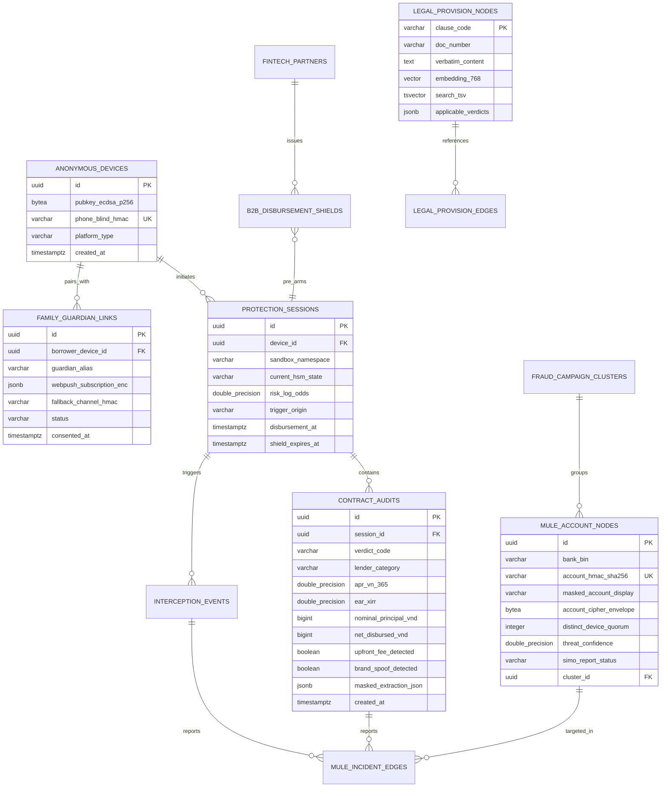
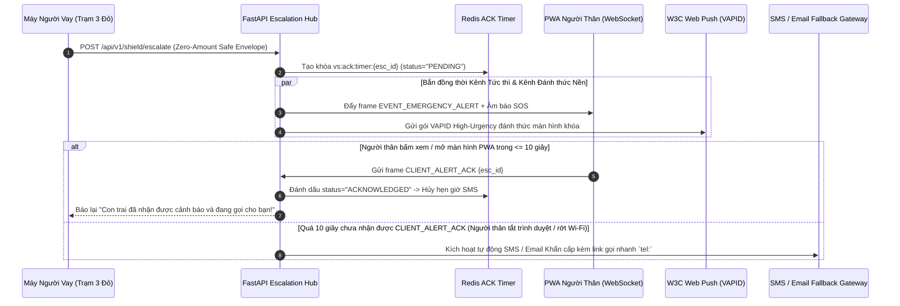

# SESSION 4 (v2.0 Ultra-Deep Edition) — Kiến Trúc Dữ Liệu Đa Mô Hình, Đồ Thị Tài Khoản Mồi (Kể Cả `Dynamic VA`), Giao Thức API Chịu Tải Cao, Mật Mã Luật 91/2025 & 26 Edge Cases Dữ Liệu/Bảo Mật

**Dự án:** **VayShield AI**  
**Vai trò đồng chủ trì Session 4:** Database Architect • Senior Backend Engineer • Cybersecurity & Cryptography Architect • Principal Software Architect • Senior Android Engineer • QA Security Lead.

---

## 1. Kiến Trúc Phân Vùng Lưu Trữ 4 Tầng Theo Mức Độ Nhạy Cảm Pháp Lý (Zero-PII Data Zoning)

Để đáp ứng đồng thời hiệu năng phản hồi thời gian thực (`< 50ms` ở Edge, `< 200ms` qua WebSocket) và tuân thủ nghiêm ngặt **Luật Bảo vệ dữ liệu cá nhân số 91/2025/QH15** (xếp lịch sử giao dịch và thông tin tài khoản ngân hàng vào nhóm *Dữ liệu cá nhân nhạy cảm*), toàn bộ dữ liệu hệ thống được cách ly vật lý thành **4 Vùng (Data Zones)**:

```mermaid
flowchart LR
    subgraph Z0["Zone 0: Volatile Ephemeral RAM (0 Disk Persistence)"]
        R1["Android Notification Stream (< 2ms OTP Wipe)"]
        R2["Encrypted Temp Image Buffer (AES-256-GCM, TTL <= 15m cho Pro Crop)"]
    end

    subgraph Z1["Zone 1: Encrypted Edge Vault (Android SQLCipher + Keystore TEE)"]
        E1["Local HSM State & Call History Timestamps"]
        E2["Ed25519 Signed Policy & Mule Bloom Filter"]
        E3["Offline Escalation Outbox Queue"]
    end

    subgraph Z2["Zone 2: High-Speed State & Event Plane (Redis 7)"]
        M1["Active 24h Shield Sessions & Bayesian Log-Odds"]
        M2["Atomic Lua Anti-Smurfing & Idempotency Locks"]
        M3["WebSocket Pub/Sub & ACK Escalation Timers"]
    end

    subgraph Z3["Zone 3: Durable Analytical, Vector & Graph Core (PostgreSQL 16)"]
        P1["Masked Contract Audits & Protection Sessions (UUIDv7)"]
        P2["Legal GraphRAG (pgvector HNSW + tsvector BM25)"]
        P3["Pre-SIMO Mule Graph (HMAC Blind Index + KMS Envelope)"]
        P4["Append-Only Audit Log & B2B Shield Ledger"]
    end

    Z0 -->|"Chỉ xuất đặc trưng đã che PII"| Z1
    Z0 -->|"Chỉ xuất JSON tham số sạch"| Z3
    Z1 <-->|"Đồng bộ trạng thái ẩn danh"| Z2
    Z2 <-->|"Ghi nhận sự kiện bền vững"| Z3
```



---

## 2. Sơ Đồ Quan Hệ Thực Thể (ERD) & Mã Nguồn SQL DDL Chuẩn Sản Xuất (`PostgreSQL 16`)

### 2.1. Sơ Đồ ERD Tổng Thể Tầng Bền Vững (`PostgreSQL 16 + pgvector + pg_trgm`)



---

### 2.2. Mã Nguồn SQL DDL Đầy Đủ Cho `PostgreSQL 16` (Tối Ưu UUIDv7, HNSW, GIN Trigram & Append-Only)

> [!IMPORTANT]
> Toàn bộ khóa chính giao dịch sử dụng chuẩn **UUIDv7 (Time-Ordered UUID)** để đảm bảo thứ tự chèn tuần tự trên B-Tree Index (tăng thông lượng ghi gấp 3–5 lần so với `UUIDv4` ngẫu nhiên và tích hợp sẵn dấu thời gian mili-giây). Mọi bảng nhạy cảm đều cài ràng buộc kiểm tra không lưu PII thô.

```sql
-- ============================================================================
-- VAYSHIELD AI - CORE POSTGRESQL 16 + PGVECTOR + PG_TRGM SCHEMA
-- Compliance: Vietnam Personal Data Protection Law No. 91/2025/QH15
-- ============================================================================

CREATE EXTENSION IF NOT EXISTS "pgcrypto";
CREATE EXTENSION IF NOT EXISTS "vector";
CREATE EXTENSION IF NOT EXISTS "pg_trgm";
CREATE EXTENSION IF NOT EXISTS "unaccent";

-- 1. Danh mục Tổ chức Tín dụng, 16 Công ty Tài chính, P2P Sandbox, Chuỗi Cầm cố & Ví Trả Sau hợp pháp
CREATE TABLE licensed_lender_registry (
    id                  UUID PRIMARY KEY DEFAULT gen_random_uuid(),
    entity_code         VARCHAR(64) UNIQUE NOT NULL,         -- VD: 'FINCO_HOMECREDIT', 'BANK_VCB', 'P2P_SANDBOX_01'
    legal_category      VARCHAR(32) NOT NULL CHECK (legal_category IN (
        'COMMERCIAL_BANK', 'LICENSED_FINCO', 'P2P_SANDBOX', 'LICENSED_PAWN_CHAIN', 'BNPL_WALLET_PROVIDER'
    )),
    official_short_name VARCHAR(120) NOT NULL,
    official_legal_name VARCHAR(255) NOT NULL,
    normalized_name      VARCHAR(255) NOT NULL,               -- Phục vụ chống giả mạo tên na ná (pg_trgm)
    sbv_license_no      VARCHAR(100),
    official_domains    TEXT[] NOT NULL DEFAULT '{}',
    official_hotlines   TEXT[] NOT NULL DEFAULT '{}',
    android_packages    JSONB NOT NULL DEFAULT '[]'::jsonb,  -- [{"pkg": "vn.homecredit.hcvn", "sha256": "..."}]
    sandbox_cap_vnd     BIGINT,                              -- 100,000,000 cho P2P Sandbox theo QĐ 2866/QĐ-NHNN
    effective_from      DATE NOT NULL DEFAULT CURRENT_DATE,
    effective_to        DATE,
    is_active           BOOLEAN NOT NULL DEFAULT TRUE,
    updated_at          TIMESTAMPTZ NOT NULL DEFAULT NOW()
);

CREATE INDEX idx_lender_trgm_name ON licensed_lender_registry USING GIN (normalized_name gin_trgm_ops);

-- 2. Thiết bị Người dùng Ẩn danh (Zero Raw Phone / Zero CCCD + Hỗ trợ Xoay vòng Pepper)
CREATE TABLE anonymous_devices (
    id                  UUID PRIMARY KEY,                    -- UUIDv7 sinh từ tầng App/Backend
    pubkey_ecdsa_p256   BYTEA,                               -- Khóa công khai xác thực chữ ký thiết bị Android Keystore
    phone_blind_hmac    VARCHAR(64) UNIQUE,                  -- HMAC-SHA256(Pepper_vK, Normalized_E164_Phone)
    pepper_version      SMALLINT NOT NULL DEFAULT 1,         -- Phục vụ xoay vòng khóa mật mã không gián đoạn
    phone_optin_exp_at  TIMESTAMPTZ,                         -- Chống lỗi nhà mạng thu hồi SIM cấp lại cho người mới
    platform_type       VARCHAR(24) NOT NULL CHECK (platform_type IN ('ANDROID_NATIVE', 'WEB_PWA', 'JUDGE_SANDBOX')),
    daily_wage_vnd      INTEGER NOT NULL DEFAULT 320000 CHECK (daily_wage_vnd BETWEEN 50000 AND 10000000),
    policy_version      INTEGER NOT NULL DEFAULT 1,
    created_at          TIMESTAMPTZ NOT NULL DEFAULT NOW(),
    last_seen_at        TIMESTAMPTZ NOT NULL DEFAULT NOW()
);

-- 3. Liên kết Người thân Đồng thuận Kép (Mutual Opt-in Pairing, Mặc định không tồn tại)
CREATE TABLE family_guardian_links (
    id                          UUID PRIMARY KEY,
    borrower_device_id          UUID NOT NULL REFERENCES anonymous_devices(id) ON DELETE CASCADE,
    guardian_alias              VARCHAR(64) NOT NULL,        -- VD: "Con trai Minh Khoa" (không bắt buộc tên thật)
    pairing_code_hash           VARCHAR(64),                 -- SHA-256 của mã phiên 6 ký tự (xóa sau khi confirm)
    pairing_expires_at          TIMESTAMPTZ,
    webpush_subscription_cipher BYTEA,                       -- AES-256-GCM(Endpoint + p256dh + auth)
    fallback_contact_cipher     BYTEA,                       -- AES-256-GCM(Email/Phone dự phòng do chính người thân nhập)
    status                      VARCHAR(24) NOT NULL CHECK (status IN ('PENDING_CONFIRM', 'ACTIVE', 'REVOKED_BY_BORROWER', 'REVOKED_BY_GUARDIAN', 'PUSH_EXPIRED_410')),
    consented_at                TIMESTAMPTZ,
    revoked_at                  TIMESTAMPTZ,
    created_at                  TIMESTAMPTZ NOT NULL DEFAULT NOW()
);

CREATE INDEX idx_family_active_borrower ON family_guardian_links(borrower_device_id) WHERE status = 'ACTIVE';

-- 4. Phiên Hành trình Bảo vệ Đa Luồng (Multi-Fiber Semilattice HSM Persistence)
CREATE TABLE protection_sessions (
    id                  UUID PRIMARY KEY,                    -- UUIDv7
    device_id           UUID NOT NULL REFERENCES anonymous_devices(id) ON DELETE CASCADE,
    fiber_key           VARCHAR(80) NOT NULL DEFAULT 'default', -- Phân biệt tối đa 8 khoản vay song song trong ngày
    sandbox_namespace   VARCHAR(64),                         -- Cô lập phiên thử nghiệm trực tuyến của từng Giám khảo
    current_hsm_state   VARCHAR(40) NOT NULL CHECK (current_hsm_state IN (
        'S0_IDLE', 'S1_LOAN_EXPLORATION', 'S2_CONTRACT_AUDITING',
        'S3_ADVANCE_FEE_HARD_STOP', 'S4_SHIELD_ARMED_24H',
        'S5_CRITICAL_INTERCEPTION', 'S6_COOLING_OFF_LOCK',
        'S7_ESCALATED_SCAM_CONFIRMED', 'S8_SAFE_ROUTINE_TX', 'S9_GOLDEN_HOUR_TRIAGE'
    )),
    risk_log_odds       DOUBLE PRECISION NOT NULL DEFAULT -3.5,
    trigger_origin      VARCHAR(32) NOT NULL CHECK (trigger_origin IN ('STATION_1_APK', 'STATION_2_SCAN', 'STATION_2_VOICE', 'STATION_3_NOTIF', 'B2B_PARTNER_WEBHOOK', 'SANDBOX_SIM')),
    amount_bucket_tier  VARCHAR(24),                         -- VD: 'TIER_10M_30M' (Không lưu số dư/số tiền giải ngân lẻ định danh)
    smurf_open_count    SMALLINT NOT NULL DEFAULT 0,
    disbursement_at     TIMESTAMPTZ,
    shield_expires_at   TIMESTAMPTZ,
    created_at          TIMESTAMPTZ NOT NULL DEFAULT NOW(),
    updated_at          TIMESTAMPTZ NOT NULL DEFAULT NOW()
);

CREATE INDEX idx_sessions_active_shield ON protection_sessions(device_id, shield_expires_at)
    WHERE current_hsm_state IN ('S3_ADVANCE_FEE_HARD_STOP', 'S4_SHIELD_ARMED_24H', 'S6_COOLING_OFF_LOCK', 'S7_ESCALATED_SCAM_CONFIRMED', 'S9_GOLDEN_HOUR_TRIAGE');

-- 5. Hồ sơ Kiểm toán Hợp đồng Trạm 2 (Đồng bộ 9 Mã Phán Quyết & Khoảng Nhạy APR)
CREATE TABLE contract_audits (
    id                      UUID PRIMARY KEY,
    session_id              UUID NOT NULL REFERENCES protection_sessions(id) ON DELETE CASCADE,
    image_count             SMALLINT NOT NULL CHECK (image_count BETWEEN 0 AND 4), -- 0 khi dùng chế độ Đọc miệng Voice-to-Cashflow
    verdict_code            VARCHAR(40) NOT NULL CHECK (verdict_code IN (
        'V_RED_ADVANCE_FEE', 'V_RED_BRAND_SPOOF', 'V_RED_BNPL_OR_STRAW_SCAM', 'V_RED_CRIMINAL_USURY',
        'V_ORANGE_CIVIL_CAP_EXCEEDED', 'V_ORANGE_PAWN_HIGH_FEE', 'V_YELLOW_HIGH_COST_LICENSED',
        'V_AMBER_INCOMPLETE_DOC', 'V_GREEN_TRANSPARENT'
    )),
    lender_category_resolved VARCHAR(32) NOT NULL,
    claimed_brand_normalized VARCHAR(255),
    matched_lender_id        UUID REFERENCES licensed_lender_registry(id),
    nominal_principal_vnd    BIGINT CHECK (nominal_principal_vnd > 0),
    net_disbursed_vnd        BIGINT CHECK (net_disbursed_vnd >= 0),
    total_repayment_vnd      BIGINT CHECK (total_repayment_vnd > 0),
    tenure_days              INTEGER CHECK (tenure_days > 0),
    apr_vn_365               DOUBLE PRECISION,               -- Null nếu là V_RED_ADVANCE_FEE (lãi vô cực)
    apr_min_bound            DOUBLE PRECISION,               -- Cận dưới khoảng nhạy khi ảnh mờ phụ phí
    apr_max_bound            DOUBLE PRECISION,               -- Cận trên khoảng nhạy
    ear_xirr                 DOUBLE PRECISION,
    lost_workdays            DOUBLE PRECISION,
    upfront_fee_detected     BOOLEAN NOT NULL DEFAULT FALSE,
    brand_spoof_detected     BOOLEAN NOT NULL DEFAULT FALSE,
    vietqr_extracted         BOOLEAN NOT NULL DEFAULT FALSE,
    user_edited_numbers      BOOLEAN NOT NULL DEFAULT FALSE,
    masked_extraction_json   JSONB NOT NULL,                 -- Đã chạy PII Scrubber xóa tên/CCCD/SĐT người vay
    cited_legal_clauses      TEXT[] NOT NULL DEFAULT '{}',
    processing_latency_ms    INTEGER NOT NULL,
    model_tier_used          VARCHAR(32) NOT NULL,           -- 'GEMINI_FLASH', 'GEMINI_PRO_ESCALATED', 'VOICE_SLANG_PARSER', 'LOCAL_OCR_FALLBACK'
    created_at               TIMESTAMPTZ NOT NULL DEFAULT NOW()
);

-- 6. Sự kiện Đánh chặn Sau Giải ngân Trạm 3 & Phân loại Bản thể học 10 Trục
CREATE TABLE interception_events (
    id                      UUID PRIMARY KEY,
    session_id              UUID NOT NULL REFERENCES protection_sessions(id) ON DELETE CASCADE,
    audio_call_state        VARCHAR(32) NOT NULL CHECK (audio_call_state IN ('ACTIVE_CELLULAR', 'ACTIVE_VOIP', 'ENDED_WITHIN_180S', 'NONE')),
    screen_share_detected   BOOLEAN NOT NULL DEFAULT FALSE,  -- Phát hiện MediaProjection / AnyDesk / TeamViewer
    computed_scam_prob      DOUBLE PRECISION NOT NULL CHECK (computed_scam_prob BETWEEN 0.0 AND 1.0),
    detected_ontology_axes  TEXT[] NOT NULL DEFAULT '{}',    -- C1..C10
    masked_user_utterance   TEXT,                            -- Lời khai đã xóa mọi tên riêng/SĐT
    cooling_off_seconds     SMALLINT NOT NULL DEFAULT 15,
    outcome_action          VARCHAR(32) NOT NULL CHECK (outcome_action IN ('USER_ABORTED_TRANSFER', 'ESCALATED_TO_FAMILY', 'FAMILY_RESCUE_CARD_DELIVERED', 'GOLDEN_HOUR_TRIAGE_ENTERED', 'VERIFIED_ROUTINE_SAFE', 'OFFLINE_QUEUED_SYNCED')),
    family_ack_latency_ms   INTEGER,
    rescue_card_received_at TIMESTAMPTZ,
    created_at              TIMESTAMPTZ NOT NULL DEFAULT NOW()
);

-- 7. Kho Tri thức Pháp luật Vector + Full-Text (Verdict-Pinned Legal GraphRAG)
CREATE TABLE legal_provision_nodes (
    clause_code         VARCHAR(64) PRIMARY KEY,             -- VD: 'BLDS_2015_D468_K1', 'BLHS_2015_D201_K1', 'ND_94_2025_P2P'
    doc_type            VARCHAR(32) NOT NULL,                -- 'LUAT', 'NGHI_DINH', 'THONG_TU', 'QUYET_DINH_NHNN'
    doc_number          VARCHAR(64) NOT NULL,
    effective_date      DATE NOT NULL,
    is_currently_valid  BOOLEAN NOT NULL DEFAULT TRUE,
    title_vi            VARCHAR(255) NOT NULL,
    verbatim_content    TEXT NOT NULL,
    plain_summary_vi    TEXT NOT NULL,                       -- Bản diễn giải chuẩn đã qua thẩm định pháp chế cho người lao động
    applicable_verdicts TEXT[] NOT NULL DEFAULT '{}',
    embedding_768       VECTOR(768) NOT NULL,
    search_tsv          TSVECTOR GENERATED ALWAYS AS (to_tsvector('simple', verbatim_content)) STORED
);

CREATE INDEX idx_legal_hnsw_vec ON legal_provision_nodes USING hnsw (embedding_768 vector_cosine_ops) WITH (m = 16, ef_construction = 64);
CREATE INDEX idx_legal_gin_tsv ON legal_provision_nodes USING GIN (search_tsv);

CREATE TABLE legal_provision_edges (
    source_clause       VARCHAR(64) NOT NULL REFERENCES legal_provision_nodes(clause_code),
    target_clause       VARCHAR(64) NOT NULL REFERENCES legal_provision_nodes(clause_code),
    relation_type       VARCHAR(32) NOT NULL CHECK (relation_type IN ('EXEMPTS_FOR_CREDIT_INST', 'CRIMINALIZES_EXCESS_OF', 'AMENDS', 'GUIDES_IMPLEMENTATION')),
    PRIMARY KEY (source_clause, target_clause, relation_type)
);

-- 8. Đồ thị Tình báo Tài khoản Mồi Trước SIMO (Pre-SIMO Mule Intelligence Graph)
CREATE TABLE fraud_campaign_clusters (
    id                      UUID PRIMARY KEY,
    campaign_label          VARCHAR(160) NOT NULL,           -- Do AI Fraud Copilot sinh tự động
    impersonated_lender_id  UUID REFERENCES licensed_lender_registry(id),
    dominant_scam_trap      VARCHAR(32) NOT NULL,            -- 'TRAP_1_ADVANCE_FEE', 'TRAP_2_SHARK_APK', 'TRAP_3_LOAN_RECALL'
    centroid_embedding      VECTOR(768),
    incident_count_24h      INTEGER NOT NULL DEFAULT 1,
    severity_level          VARCHAR(16) NOT NULL CHECK (severity_level IN ('WATCH', 'ELEVATED', 'CRITICAL_WAVE')),
    draft_advisory_text     TEXT,
    first_seen_at           TIMESTAMPTZ NOT NULL DEFAULT NOW(),
    last_seen_at            TIMESTAMPTZ NOT NULL DEFAULT NOW()
);

CREATE TABLE mule_account_nodes (
    id                      UUID PRIMARY KEY,
    bank_bin                VARCHAR(12) NOT NULL,            -- Mã BIN 6 số NAPAS (VD: '970436', '970407')
    account_hmac_sha256     VARCHAR(64) UNIQUE NOT NULL,     -- HMAC-SHA256(Mule_Pepper, BankBIN || ':' || NormalizedAccNo)
    va_prefix_hmac          VARCHAR(64),                     -- Bắt bài Tài khoản Ảo Động (Dynamic VA đầu 963../968.. chung Merchant lừa đảo!)
    pepper_version          SMALLINT NOT NULL DEFAULT 1,
    masked_account_display  VARCHAR(32) NOT NULL,            -- VD: '1903****8899' hoặc Alias 'NGUYENVANB***'
    account_holder_masked   VARCHAR(64),                     -- VD: 'NGUYEN V** B'
    account_cipher_envelope BYTEA NOT NULL,                  -- Mã hóa khóa bao (Envelope KMS) chỉ giải mã khi xuất hồ sơ chính thức SIMO/A05
    distinct_device_quorum  INTEGER NOT NULL DEFAULT 1,      -- Số thiết bị độc lập báo cáo (Chống tấn công vu khống Sybil!)
    threat_confidence       DOUBLE PRECISION NOT NULL DEFAULT 0.35,
    simo_dossier_status     VARCHAR(24) NOT NULL DEFAULT 'OBSERVING' CHECK (simo_dossier_status IN (
        'OBSERVING', 'QUORUM_REACHED', 'REVIEWED_CONFIRMED', 'EXPORTED_TO_SIMO', 'FALSE_POSITIVE_DISMISSED'
    )),
    cluster_id              UUID REFERENCES fraud_campaign_clusters(id),
    first_reported_at       TIMESTAMPTZ NOT NULL DEFAULT NOW(),
    last_reported_at        TIMESTAMPTZ NOT NULL DEFAULT NOW()
);

CREATE INDEX idx_mule_va_prefix ON mule_account_nodes(bank_bin, va_prefix_hmac) WHERE va_prefix_hmac IS NOT NULL;

CREATE TABLE mule_incident_edges (
    id                  UUID PRIMARY KEY,
    mule_node_id        UUID NOT NULL REFERENCES mule_account_nodes(id) ON DELETE CASCADE,
    reporter_device_id  UUID NOT NULL REFERENCES anonymous_devices(id),
    source_audit_id     UUID REFERENCES contract_audits(id),
    source_intercept_id UUID REFERENCES interception_events(id),
    evidence_channel    VARCHAR(32) NOT NULL CHECK (evidence_channel IN ('VIETQR_CRYPTO_DECODED', 'OCR_RECEIPT_EXTRACTED', 'VOICE_CHAT_REPORTED')),
    scam_script_vec     VECTOR(768),
    created_at          TIMESTAMPTZ NOT NULL DEFAULT NOW(),
    CONSTRAINT uq_one_vote_per_device_per_mule UNIQUE (mule_node_id, reporter_device_id) -- Mỗi thiết bị chỉ được tính 1 phiếu Quorum cho 1 STK!
);

-- 9. Đối tác B2B Fintech & Sổ cái Kích hoạt Khiên Sau Giải ngân
CREATE TABLE fintech_partners (
    id                  UUID PRIMARY KEY,
    partner_code        VARCHAR(64) UNIQUE NOT NULL,
    organization_name   VARCHAR(200) NOT NULL,
    lender_registry_id  UUID REFERENCES licensed_lender_registry(id),
    api_key_prefix      VARCHAR(16) UNIQUE NOT NULL,
    hmac_secret_cipher  BYTEA NOT NULL,
    rate_limit_rpm      INTEGER NOT NULL DEFAULT 600,
    is_active           BOOLEAN NOT NULL DEFAULT TRUE,
    created_at          TIMESTAMPTZ NOT NULL DEFAULT NOW()
);

CREATE TABLE b2b_disbursement_shields (
    id                      UUID PRIMARY KEY,
    partner_id              UUID NOT NULL REFERENCES fintech_partners(id),
    idempotency_key         VARCHAR(128) NOT NULL,
    borrower_phone_hmac     VARCHAR(64) NOT NULL,            -- Blind Index khớp với anonymous_devices.phone_blind_hmac
    matched_session_id      UUID REFERENCES protection_sessions(id),
    amount_bucket_tier      VARCHAR(24) NOT NULL,
    shield_duration_hours   SMALLINT NOT NULL DEFAULT 24 CHECK (shield_duration_hours BETWEEN 1 AND 72),
    status                  VARCHAR(24) NOT NULL CHECK (status IN ('ARMED_ON_DEVICE', 'PENDING_USER_ONLINE', 'NO_DEVICE_OPTED_IN')),
    created_at              TIMESTAMPTZ NOT NULL DEFAULT NOW(),
    UNIQUE (partner_id, idempotency_key)
);

-- Cô lập tuyệt đối dữ liệu giữa các đối tác Fintech B2B bằng Row-Level Security (RLS)
ALTER TABLE b2b_disbursement_shields ENABLE ROW LEVEL SECURITY;
CREATE POLICY pol_b2b_tenant_isolation ON b2b_disbursement_shields
    USING (partner_id = NULLIF(current_setting('app.current_partner_id', TRUE), '')::UUID);

-- 10. Nhật ký Pháp chứng Chuỗi Băm Bất Biến (Tamper-Evident Hash-Chain Audit Log cho SIMO/KMS)
CREATE TABLE tamper_evident_audit_chain (
    seq_no          BIGSERIAL PRIMARY KEY,
    actor_id        VARCHAR(120) NOT NULL,                   -- ID chuyên viên Fraud Ops hoặc Partner Key
    action_type     VARCHAR(64) NOT NULL,                    -- 'UNSEAL_MULE_FOR_SIMO', 'POLICY_BUNDLE_SIGNED', 'DEVICE_DATA_WIPED'
    target_ref_id   UUID NOT NULL,
    prev_entry_hash VARCHAR(64) NOT NULL,                    -- Liên kết mật mã với bản ghi liền trước (Genesis = '0000...0')
    entry_hash      VARCHAR(64) UNIQUE NOT NULL,             -- SHA-256(prev_entry_hash || actor_id || action_type || target_ref_id || created_at)
    created_at      TIMESTAMPTZ NOT NULL DEFAULT NOW()
);

CREATE OR REPLACE FUNCTION forbid_audit_chain_mutation() RETURNS TRIGGER AS $$
BEGIN
    RAISE EXCEPTION 'IMMUTABLE_AUDIT_CHAIN_VIOLATION: Updates and deletes are strictly prohibited';
END;
$$ LANGUAGE plpgsql;

CREATE TRIGGER trg_immutable_audit_chain
    BEFORE UPDATE OR DELETE ON tamper_evident_audit_chain
    FOR EACH ROW EXECUTE FUNCTION forbid_audit_chain_mutation();
```

---

## 3. Thiết Kế Keyspace `Redis 7`, Kịch Bản Nguyên Tử Lua & Schema Ngoại Tuyến `Android SQLCipher`

### 3.1. Bảng Chuẩn Hóa Keyspace & TTL Trên `Redis 7`

| Mẫu Khóa Redis (Key Pattern) | Kiểu Dữ Liệu | TTL Chuẩn | Mục Đích Nghiệp Vụ & Tốc Độ |
| :--- | :---: | :---: | :--- |
| `vs:shield:state:{device_id}` | `HASH` | `24h–72h` | Lưu trạng thái HSM nóng (`state`, `log_odds`, `disb_ts`, `last_call_end_ts`) phục vụ đồng bộ `<1ms`. |
| `vs:smurf:win:{session_id}` | `ZSET` | `15m` | Cửa sổ trượt dấu thời gian mở lặp lại App Ngân hàng (chống chia nhỏ giao dịch). |
| `vs:idem:notif:{device_id}:{hash}` | `STRING` | `10m` | Khử trùng lặp khi cả SMS Banking lẫn App Push cùng báo biến động số dư giải ngân. |
| `vs:idem:b2b:{partner_id}:{key}` | `STRING` | `48h` | Đảm bảo đối tác Fintech bắn lại Webhook không tạo trùng phiên bảo vệ. |
| `vs:pair:code:{code_6char}` | `HASH` | `10m` | Lưu phiên ghép đôi người thân (`device_id`, `fail_attempts <= 3`). |
| `vs:ws:ticket:{one_time_token}` | `STRING` | `45s` | Vé bắt tay 1 lần cho kết nối WebSocket (tránh truyền JWT dài trên URL). |
| `vs:ack:timer:{escalation_id}` | `HASH` | `5m` | Theo dõi trạng thái đã đọc (`ACK`) của người thân để tự động leo thang Web Push $\to$ SMS/Email. |
| `vs:chan:family:{borrower_dev_id}` | `PUBSUB` | Realtime | Kênh phát sóng trực tiếp cảnh báo khẩn cấp sang các worker giữ kết nối PWA của người thân. |

### 3.2. Kịch Bản Redis Lua Nguyên Tử Chống Chia Nhỏ Giao Dịch (`atomic_smurf_and_risk_eval.lua`)

Thực thi toàn bộ phép trượt cửa sổ 15 phút, tăng bộ đếm mở lặp lại app ngân hàng và tính xác suất hậu nghiệm trong **1 thao tác nguyên tử duy nhất (không có Race Condition)**:

```lua
-- KEYS[1]: vs:smurf:win:{session_id}
-- KEYS[2]: vs:shield:state:{device_id}
-- ARGV[1]: now_epoch_ms
-- ARGV[2]: event_uuid
-- ARGV[3]: call_synergy_weight (3.8 for active call, 1.9 for ended <=180s, 0.0 otherwise)

local win_key = KEYS[1]
local state_key = KEYS[2]
local now_ms = tonumber(ARGV[1])
local cutoff_ms = now_ms - (15 * 60 * 1000)

-- 1. Xóa các lần mở app ngân hàng cũ hơn 15 phút và ghi nhận lần mở hiện tại
redis.call('ZREMRANGEBYSCORE', win_key, '-inf', cutoff_ms)
redis.call('ZADD', win_key, now_ms, ARGV[2])
redis.call('PEXPIRE', win_key, 15 * 60 * 1000)

local open_count_15m = redis.call('ZCARD', win_key)
local base_log_odds = tonumber(redis.call('HGET', state_key, 'base_log_odds') or '-3.5')
local synergy = tonumber(ARGV[3])
local smurf_boost = 0.0
if open_count_15m > 1 then
    smurf_boost = 0.9 * (open_count_15m - 1)
end

local total_log_odds = base_log_odds + synergy + smurf_boost
local prob = 1.0 / (1.0 + math.exp(-total_log_odds))

redis.call('HSET', state_key, 'last_prob', tostring(prob), 'smurf_count', tostring(open_count_15m))
return {tostring(prob), open_count_15m}
```

### 3.3. Schema Lưu Trữ Mã Hóa Cục Bộ Trên Thiết Bị Android (`Room + SQLCipher AES-256`)

Kho dữ liệu cục bộ trên máy Cô Lan được mã hóa toàn phần bằng `SQLCipher` với khóa sinh từ chip bảo mật phần cứng `Android Keystore`, gồm 4 bảng gọn nhẹ (`< 5MB`):
1. `LocalProtectionStateEntity`: Lưu trạng thái HSM hiện tại, `disbursementTimestampMs`, `shieldExpiresAtMs`, `lastCallEndedAtMs`, `recentBankOpenTimestampsJson` $\rightarrow$ Phục hồi tức thì sau khi khởi động lại máy hoặc bị Xiaomi HyperOS thu hồi RAM.
2. `CachedLicensedPackageEntity`: Bảng danh sách trắng `packageName` + mảng băm chữ ký `signingCertSha256` của 40+ Ngân hàng, 16 FinCos và Ví điện tử chính thống tại Việt Nam $\rightarrow$ Phục vụ Trạm 1 và Whitelist Trạm 3 trong `< 1ms` offline.
3. `SignedPolicyBundleEntity`: Lưu gói trọng số chấm điểm và `MuleAccountBloomFilter` kèm chữ ký `Ed25519` của Server.
4. `OfflineEscalationOutboxEntity`: Hàng đợi sự kiện cảnh báo khẩn cấp được `WorkManager` (`NetworkType.CONNECTED`) tự động gửi bù lên Backend ngay giây phút máy có lại kết nối 4G/Wi-Fi sau cuộc gọi DSDS.

---

## 4. Đặc Tả Hợp Đồng Giao Tiếp API (OpenAPI 3.1 REST, SSE 5 Pha, WebSocket ACK Cascade & B2B Webhook)

### 4.1. Tổng Quan Danh Mục Endpoints Cốt Lõi

| Nhóm | Method & Đường dẫn (Endpoint) | Cơ chế Xác thực | Giao thức & SLA Mục tiêu |
| :--- | :--- | :--- | :--- |
| **Edge & Policy** | `POST /api/v1/devices/register` | Public + PoW / RateLimit | REST JSON (`< 80ms`) — Đăng ký thiết bị ẩn danh & khóa ECDSA |
| **Edge & Policy** | `GET /api/v1/policies/latest` | Device Signature + `ETag` | REST JSON (`< 40ms`) — Đồng bộ gói quy tắc ký số `Ed25519` |
| **Trạm 1** | `POST /api/v1/audits/apk-verify` | Device Signature | REST JSON (`< 90ms`) — Kiểm định chữ ký APK & quyền nguy hiểm |
| **Trạm 2** | `POST /api/v1/audits/contract-stream` | Device Sig / Sandbox Token | **Multipart $\to$ SSE Stream** (`First Event < 200ms`, `Full < 3.5s`) |
| **Trạm 2** | `POST /api/v1/audits/voice-terms` | Device Sig / Sandbox Token | REST / Audio-to-JSON (`< 1.8s`) — Đọc miệng điều khoản khi bị chặn chụp ảnh |
| **Trạm 2** | `POST /api/v1/audits/{id}/recalculate` | Device Sig / Sandbox Token | REST JSON (`< 15ms`) — Giải lại dòng tiền tất định khi user sửa số |
| **Trạm 3** | `POST /api/v1/shield/arm` | Device Sig / Sandbox Token | REST JSON (`< 60ms`) — Đồng bộ kích hoạt Khiên 24h |
| **Trạm 3** | `POST /api/v1/shield/evaluate-response` | Device Sig / Sandbox Token | REST JSON (`< 900ms`) — Phân tích 10 trục Ontology & chống mớm lời |
| **Trạm 3 & Gia đình** | `POST /api/v1/shield/escalate` | Device Sig / Sandbox Token | REST $\to$ **WS + Push + SMS Cascade** (`WS < 250ms`) |
| **Gia đình** | `POST /api/v1/family/send-rescue-card` | Guardian Session Token | REST $\to$ **WS Reverse Push (`< 150ms`)** — Bắn Thẻ Giải cứu 2 chiều lên máy Mẹ |
| **Cấp cứu S9** | `POST /api/v1/triage/golden-hour-dossier` | Device Sig / Sandbox Token | REST JSON/PDF (`< 120ms`) — Xuất hotline phong tỏa & đơn trình báo Giờ Vàng |
| **Gia đình** | `POST /api/v1/family/pair-init` & `/pair-confirm` | Device Sig / Pairing Code | REST JSON — Ghép đôi đồng thuận 2 chiều qua QR 6 ký tự |
| **Realtime Hub** | `GET /ws/v1/guardian?ticket={ott}` | One-Time Ticket (`45s` TTL) | **WebSocket Hai Chiều** (Ping `20s`, `ACK` xác nhận đã nhận tin) |
| **B2B Fintech** | `POST /api/v1/b2b/disbursement-shield` | `HMAC-SHA256` + `Idempotency-Key` | REST Webhook (`< 70ms`) — Kích hoạt Khiên 24h bằng Blind Index |
| **B2B Fraud Ops** | `GET /api/v1/ops/mule-clusters` & `/simo-dossier` | RBAC JWT (`FRAUD_ANALYST`) | REST + SSE Live Threat Feed cho bàn làm việc Fintech |
| **Judge Sandbox** | `POST /api/v1/sandbox/simulate-event` | Ephemeral `X-Sandbox-Session` | Chạy xuyên suốt 100% lõi thật trong không gian tên cô lập cho Giám khảo |

---

### 4.2. Đặc Tả Payload Chuẩn Cho 3 Giao Thức Trọng Yếu Nhất

#### (A) Giao Thức Streaming 5 Pha Tại Trạm 2: `POST /api/v1/audits/contract-stream`
Client tải lên `1..4` file ảnh (`images[]`, định dạng `image/webp` hoặc `image/jpeg`, tối đa `1.5MB/ảnh`) kèm `metadata_json` (chứa nguồn chụp, thông tin APK nếu liên kết từ Trạm 1). Server giữ kết nối `text/event-stream` phát lần lượt 5 sự kiện chuẩn:

```text
event: audit.sanitized
data: {"audit_id":"019361a8-7c10-7000-8000-112233445566","image_count":2,"blur_ok":true,"elapsed_ms":112}

event: audit.vietqr_decoded
data: {"found":true,"bank_bin":"970407","masked_account":"1903****8899","mule_quorum_hit":true,"preset_amount_vnd":2000000}

event: audit.fields_extracted
data: {"claimed_lender":"Home Credit","nominal_principal_vnd":20000000,"net_disbursed_vnd":0,"upfront_fee_demanded":true,"upfront_fee_amount_vnd":2000000,"upfront_reason":"Phí mở băng sai số tài khoản","confidence":0.97}

event: audit.verdict_computed
data: {"verdict_code":"V_RED_BRAND_SPOOF","severity":"CRITICAL_RED","apr_vn_365":null,"ear_xirr":null,"lost_workdays":6.25,"official_hotline_verify":"1900 633 633","contradictions":["Ảnh mang logo Home Credit nhưng đòi chuyển 2.000.000đ phí mở băng vào tài khoản cá nhân 1903****8899"]}

event: audit.legal_explained
data: {"headline_vi":"DỪNG NGAY! Đây là bẫy mạo danh Home Credit thu phí mở khóa giả","tts_voice_script":"Cô chú dừng lại ngay! Công ty Home Credit thật không bao giờ bắt chuyển 2 triệu đồng để mở khóa tài khoản bị treo. Số tài khoản trên mã QR này đã bị cảnh báo lừa đảo!","cited_clauses":[{"code":"BLHS_2015_D174","title":"Điều 174 Bộ luật Hình sự - Tội lừa đảo chiếm đoạt tài sản"},{"code":"TT_43_2016_NHNN","title":"Quy định minh bạch cho vay tiêu dùng của Công ty Tài chính"}]}
```

#### (B) Hợp Đồng Webhook B2B Bảo Toàn Quyền Riêng Tư: `POST /api/v1/b2b/disbursement-shield`
Khi đối tác Công ty Tài chính / Ví điện tử giải ngân khoản vay thành công cho khách hàng, hệ thống Core của đối tác gọi API này với chữ ký `X-VayShield-Signature: sha256=HEX(HMAC_SHA256(partner_secret, timestamp + "." + raw_body))`:

```json
// REQUEST HEADERS:
// X-VayShield-Partner-Key: vsp_live_hc9981
// X-VayShield-Timestamp: 1795543200
// X-VayShield-Signature: sha256=8f4b2e9c1a77d0...
// Idempotency-Key: disb_tx_20261125_00918273

{
  "borrower_phone_blind_hmac": "e3b0c44298fc1c149afbf4c8996fb92427ae41e4649b934ca495991b7852b855",
  "amount_bucket_tier": "TIER_10M_30M",
  "product_type": "CASH_CONSUMER_LOAN",
  "shield_duration_hours": 24,
  "elevated_campaign_watch": true
}
```

```json
// RESPONSE 202 ACCEPTED (< 60ms):
{
  "shield_id": "019361aa-9100-7123-9a00-abcdef012345",
  "status": "ARMED_ON_DEVICE",
  "shield_expires_at": "2026-11-26T01:06:40Z",
  "pre_simo_active_wave_warning": {
    "impersonation_wave_active": true,
    "active_clusters_targeting_brand": 2
  }
}
```

#### (C) Chuỗi Leo Thang Có Xác Nhận Đã Đọc Cho Người Thân (`Delivery-Confirmed WebSocket -> Push -> SMS Cascade`)



---

## 5. Kiến Trúc Mật Mã, Chống Tấn Công Vu Khống & Ma Trận Tuân Thủ Luật 91/2025/QH15

### 5.1. Năm Cơ Chế Mật Mã & An Ninh Hệ Thống Trọng Tâm

1. **Envelope Encryption Cho Dữ Liệu Cần Thẩm Quyền Mở Niêm Phong (`KMS / Master KEK + Per-Record DEK`)**:
   - Số tài khoản nghi vấn trong `mule_account_nodes` và endpoint Web Push của người thân được mã hóa bằng khóa dữ liệu ngẫu nhiên `AES-256-GCM` riêng từng bản ghi (`DEK`), sau đó `DEK` được bọc bằng khóa chủ `KEK` nằm ngoài Database. Kể cả khi lộ bản sao lưu SQL (`Database Dump Leak`), kẻ tấn công không thể thu thập được danh sách số điện thoại hay thông tin liên lạc người thân!
2. **Blind Indexing Bằng `HMAC-SHA256` Với Pepper Độc Lập**:
   - Dùng khóa bí mật `PEPPER_B2B_PHONE` riêng để băm số điện thoại chuẩn hóa E.164 và `PEPPER_MULE_ACCOUNT` riêng để băm `BankBIN:AccountNo`. Cho phép truy vấn khớp chính xác $O(1)$ qua B-Tree Index mà không lưu văn bản rõ.
3. **Chữ Ký Bất Đối Xứng `Ed25519` Bảo Vệ Gói Quy Tắc Edge**:
   - Mọi bản cập nhật trọng số `Bayesian HSM`, danh sách `packageName` ngân hàng mới và `Mule Bloom Filter` tải về máy Android đều được kiểm tra chữ ký bằng `PublicKey_Ed25519` ghim cứng trong mã nguồn APK (`Certificate & Policy Pinning`), ngăn chặn tuyệt đối tấn công Man-in-the-Middle hạ cấp bộ lọc bảo vệ.
4. **Cơ Chế Quorum Chống Đầu Độc Đồ Thị Tài Khoản Mồi (`Anti-Poisoning / Sybil Resistance`)**:
   - Nhờ ràng buộc `UNIQUE (mule_node_id, reporter_device_id)` kết hợp chữ ký phần cứng `ECDSA P-256` của thiết bị (`Android Keystore Key Attestation`), một kẻ tấn công không thể viết script gửi 100 request giả từ 1 máy để vu khống tài khoản người bán hàng chân chính! Một tài khoản chỉ chuyển sang trạng thái `QUORUM_REACHED` khi có $\ge 2$ thiết bị vật lý độc lập báo cáo kèm bằng chứng khớp cấu trúc kịch bản lừa đảo.
5. **Xác Thực Xóa Sạch Bộ Nhớ `Zero-OTP` (`Memory Hygiene`)**:
   - Trên Android, hàm đọc thông báo ngân hàng sử dụng `CharSequence` ngắn hạn, kiểm tra biểu thức OTP ngay đầu hàm và không bao giờ gán vào biến toàn cục, không ghi `Logcat` kể cả ở bản build Debug, đảm bảo an toàn tuyệt đối trước các công cụ đọc log.

### 5.2. Bảng Đối Chiếu Tuân Thủ Luật Bảo Vệ Dữ Liệu Cá Nhân 91/2025/QH15

| Yêu Cầu Pháp Lý (Luật 91/2025/QH15, hiệu lực 01/01/2026) | Giải Pháp Kỹ Thuật Cài Đặt Cứng Trong Kiến Trúc VayShield AI |
| :--- | :--- |
| **1. Tối thiểu hóa dữ liệu thu thập (Data Minimization)** | Không thu thập tên thật, CCCD, địa chỉ nhà, danh bạ hay số dư tài khoản của người vay. Định danh thiết bị hoàn toàn ẩn danh bằng `UUIDv7` + khóa công khai. |
| **2. Sự đồng ý tường minh, tách biệt theo mục đích (Granular Consent)** | Tách rời 3 công tắc đồng thuận độc lập: *(a) Soi hợp đồng khi người dùng chủ động gửi ảnh*, *(b) Bật Khiên bảo vệ biến động giải ngân cục bộ*, *(c) Ghép đôi báo tin cho người thân (Mặc định Tắt)*. |
| **3. Bảo vệ dữ liệu tài chính nhạy cảm & Không chuyển trái phép** | 99.9% thông báo giao dịch cá nhân bị loại bỏ ngay trên thiết bị trong `<2ms`; ảnh chụp hợp đồng xử lý trên vùng nhớ tạm tự hủy $\le 15\text{ phút}$. |
| **4. Quyền rút lại sự đồng ý & Quyền xóa dữ liệu 1 chạm** | Cung cấp API `DELETE /api/v1/devices/me` và nút *"Xóa toàn bộ dữ liệu & Hủy liên kết người thân"* thực thi `ON DELETE CASCADE` tức thì trên cả PostgreSQL, Redis và SQLCipher. |

---

## 6. Danh Mục 26 Edge Cases Chuyên Sâu Của CSDL, Đồ Thị, Mật Mã, Giao Thức API & Phân Tán (`EC-DB01` $\to$ `EC-DB26`)

| Mã | Phân Nhóm Hạ Tầng | Tình Huống Biên / Lỗi Hệ Thống Ngầm (Database, Crypto & API Edge Case) | Cơ Chế Hóa Giải Cấp Kiến Trúc Trong VayShield AI |
| :--- | :--- | :--- | :--- |
| **`EC-DB01`** | **Connection Pool** | **Cạn kiệt DB Connection Pool (`QueuePool Exhaustion`)** khi 100 người dùng cùng mở luồng `SSE /contract-stream` kéo dài `4–6 giây` nếu giữ `AsyncSession` xuyên suốt generator! | **Zero-Idle-Connection SSE Pattern**: Tuyệt đối không inject `Depends(get_db)` ở hàm ngoài của `StreamingResponse`; chỉ mượn kết nối `<5ms` đầu luồng để đọc cấu hình, đóng trả ngay về Pool trong suốt lúc chờ Vision AI, và mở lại `<8ms` cuối luồng để `INSERT` kết quả! |
| **`EC-DB02`** | **Đồ thị Tài khoản Mồi** | **Tội phạm thuê cổng thanh toán sinh "Tài khoản Ảo Động" (`Dynamic Virtual Account - VA`)**: Mỗi nạn nhân nhận 1 mã QR 14 số khác nhau (`9638880001`, `9638880002`...) làm băm toàn chuỗi STK coi là các tài khoản rời rạc không bao giờ đạt ngưỡng Quorum! | Trích xuất đồng thời **`va_prefix_hmac`** (băm Mã BIN + 6–8 chữ số đầu định danh Merchant của dải VA ngân hàng). Khi $\ge 2$ mã VA khác đuôi nhưng trùng `(bank_bin, va_prefix_hmac)` xuất hiện trong kịch bản lừa đảo, hệ thống gom ngay cả dải Merchant VA vào cùng 1 cụm! |
| **`EC-DB03`** | **Viễn thông & Định danh** | **Nhà mạng thu hồi SIM không hoạt động cấp lại cho chủ thuê bao mới (`Recycled Phone Number`)**: Khi chủ mới vay tiền hợp pháp, B2B Webhook bắn nhầm Khiên về máy của chủ cũ từng đăng ký SĐT đó! | Trường `phone_optin_exp_at` yêu cầu gia hạn xác thực mềm mỗi `90 ngày`, kết hợp nút 1 chạm *"Tôi không thực hiện khoản vay này — Hủy liên kết số điện thoại"* xóa ngay `phone_blind_hmac` cũ! |
| **`EC-DB04`** | **Android Keystore** | **Người dùng đổi mã PIN khóa màn hình hoặc thêm/xóa vân tay trên Android** làm ném lỗi `KeyPermanentlyInvalidatedException`, khiến `SQLCipher` không mở được DB cục bộ và sập app liên tục! | Sinh khóa `AES-256` bọc `SQLCipher` trong `AndroidKeyStore` với cấu hình `setUserAuthenticationRequired(false)` (mã hóa phần cứng gắn với thiết bị TEE nhưng không tự hủy khi người dùng thêm ngón tay mới!), kèm cơ chế tự tạo mới kho sạch nếu phát hiện hỏng header SQLite. |
| **`EC-DB05`** | **Bảo mật Upload** | **Tấn công Bom Giải Nén Ảnh (`Image Decompression Bomb / Pixel Flood`)**: File PNG nặng chỉ `45KB` nhưng header khai báo kích thước `60.000 x 60.000 px`, giải nén bung ra `14.4 GB RAM` đánh sập Worker FastAPI! | Đọc header luồng byte đầu vào kiểm tra cứng `width * height <= 25_000_000` (25MP) và tổng dung lượng giải nén tối đa `<= 64MB` bằng `PIL.Image.MAX_IMAGE_PIXELS` TRƯỚC khi cấp phát bộ nhớ bitmap! |
| **`EC-DB06`** | **Bảo mật Upload** | **File giả mạo phần mở rộng (`Polyglot Malware / SVG chứa XXE hoặc HTML XSS` đổi tên thành `.jpg`)**. | Cấm tuyệt đối SVG/PDF/HTML ở luồng ảnh; kiểm tra **Magic Bytes thực tế** (`FF D8 FF` cho JPEG, `89 50 4E 47` cho PNG, `52 49 46 46 ... 57 45 42 50` cho WebP) và tái mã hóa lại ảnh sạch không giữ EXIF metadata. |
| **`EC-DB07`** | **Đua dữ liệu Đồ thị** | **Lost-Update khi 10 nạn nhân trong 1 nhóm chat cùng quét 1 mã QR lừa đảo ở cùng một giây** làm `distinct_device_quorum` bị tính thiếu! | Chèn vào bảng cạnh `mule_incident_edges` trước (`ON CONFLICT DO NOTHING`), sau đó cập nhật nguyên tử bảng đỉnh `SET distinct_device_quorum = (SELECT COUNT(*) FROM mule_incident_edges WHERE mule_node_id = $1)` trong cùng Transaction ngắn! |
| **`EC-DB08`** | **Xoay vòng Khóa** | **Đổi khóa bí mật `PEPPER_B2B_PHONE` hoặc `PEPPER_MULE_ACCOUNT` định kỳ** làm gãy toàn bộ tra cứu Blind Index của dữ liệu cũ! | Thiết kế **`Dual-Pepper Window` (`pepper_version`)**: Khi xoay khóa từ `v1 -> v2`, tầng truy vấn kiểm tra `WHERE account_hmac_sha256 IN (hmac_v2, hmac_v1)` và tự động nâng cấp lười (`Lazy Re-hash`) bản ghi lên `v2` khi có truy cập! |
| **`EC-DB09`** | **STK Alias Ngân hàng** | **Kẻ gian không dùng số tài khoản chữ số mà dùng Tài khoản Đặt tên / Nickname / Số điện thoại** (VD: STK là `HOTROHUYVAY247` hoặc `0988xxx` trên MB Bank / VPBank / TPBank). | Chuẩn hóa `NormalizedAccNo` thành chữ in hoa viết liền không dấu câu (`A-Z0-9`) thay vì ép kiểu `BIGINT` (sai lầm kinh điển của nhiều DB thiết kế STK dạng số nguyên làm mất số `0` ở đầu như `007100...` của Vietcombank hoặc lỗi khi gặp STK chữ cái!). |
| **`EC-DB10`** | **Chuẩn hóa SĐT** | **Lệch định dạng số điện thoại giữa đối tác B2B và thiết bị** (`0909123456` vs `+84909123456` vs `840909123456` vs đầu số cũ 11 số) làm lệch mã băm `HMAC`! | Quy chuẩn bắt buộc về định dạng **ITU-T E.164 nghiêm ngặt (`+84909123456`, bỏ số `0` thừa sau `+84`)** kèm bộ test vector đối chiếu chung trong SDK tích hợp cho đối tác B2B. |
| **`EC-DB11`** | **Redis Failover** | **Redis khởi động lại hoặc mất kết nối tạm thời 5 giây** ngay lúc thiết bị hỏi trạng thái Khiên 24h hoặc kiểm tra khóa `Idempotency-Key`. | **Read-Through & Write-Behind Resilience**: Nếu Redis timeout `> 80ms`, tự động đọc xuyên về bảng `protection_sessions` (có Partial Index nóng `< 3ms` trên PostgreSQL) và tái nạp lại bộ nhớ đệm khi Redis sống lại! |
| **`EC-DB12`** | **WebSocket Ticket** | **Vé một lần `ticket` kết nối WebSocket bị trình duyệt gửi lại khi tự động kết nối lại (Auto-Reconnect)** dẫn đến lỗi `401 Ticket Already Consumed` lặp vô tận! | Tách biệt: `GET /api/v1/ws-ticket` cấp vé mới mỗi lần hàm `useGuardianWebSocket` thực hiện bắt tay kết nối lại, đồng thời xóa vé bằng lệnh nguyên tử `GETDEL` trên Redis ngay khi nâng cấp lên `101 Switching Protocols`. |
| **`EC-DB13`** | **WebSocket Scaling** | **Người vay kết nối vào Backend Instance #1, còn Người thân kết nối WebSocket vào Backend Instance #2** sau cân bằng tải! | Mọi sự kiện cảnh báo và Thẻ giải cứu 2 chiều đều phát qua kênh **`Redis Pub/Sub` (`vs:chan:family:{id}`)** để mọi Uvicorn Worker / Cloud Run Instance đều chuyển tiếp tức thì tới đúng socket đang mở! |
| **`EC-DB14`** | **Web Push 410 Gone** | **Người thân xóa trình duyệt hoặc tắt quyền thông báo PWA** khiến máy chủ Push của Google/Apple trả lỗi `410 Gone` hoặc `404 Not Found`. | Khi nhận mã `410/404` từ dịch vụ VAPID, lập tức cập nhật `status = 'PUSH_EXPIRED_410'`, nhảy thẳng không chờ 10 giây sang **Fallback SMS / Email**, và nhắc nhẹ trên máy người vay lần mở app kế tiếp để ghép nối lại. |
| **`EC-DB15`** | **Cô lập Đa Đối tác** | **Lỗi lập trình câu lệnh SQL ở tầng API vô tình làm lộ danh sách sự kiện giải ngân của Công ty Tài chính A sang tài khoản quản trị của Công ty Tài chính B**. | Chốt chặn tầng nhân CSDL bằng **`PostgreSQL Row-Level Security (RLS)`**: Mỗi request B2B đặt biến cục bộ giao dịch `SET LOCAL app.current_partner_id = ...`; kể cả câu lệnh `SELECT *` quên `WHERE` vẫn chỉ nhìn thấy đúng dòng của đối tác đó! |
| **`EC-DB16`** | **Cô lập Giám khảo** | **Hai Giám khảo mở chung 1 link mẫu có sẵn hoặc copy URL gửi cho nhau** làm chung `sandbox_namespace` đè trạng thái của nhau. | Tách `vip=judge2026` (cờ cấp quyền Quota VIP) khỏi `sandbox_namespace` (sinh mới độc lập trong `sessionStorage` riêng của từng tab trình duyệt!). |
| **`EC-DB17`** | **pgvector HNSW** | **Chỉ mục vector `HNSW` bị suy giảm độ chính xác truy hồi khi cập nhật/ghi đè nhiều lần văn bản luật hoặc tâm cụm chiến dịch**. | Kho văn bản pháp luật có quy mô gọn (< 2.000 điều khoản) kết hợp `Iterative Index Scan` của `pgvector 0.8+` đảm bảo không bao giờ trả thiếu kết quả khi đi kèm mệnh đề lọc `WHERE is_currently_valid = TRUE`! |
| **`EC-DB18`** | **JSONB Bloat & Injection** | **Trường `masked_extraction_json` bị bơm mảng lồng nhau sâu 50 cấp hoặc nặng hàng chục MB** gây tràn bộ nhớ parser PostgreSQL. | Khóa giới hạn kích thước tổng payload JSON `< 64KB` và độ sâu lồng nhau `<= 5` ngay tại tầng xác thực Pydantic trước khi chạm tới SQLAlchemy. |
| **`EC-DB19`** | **Replay B2B Webhook** | **Lệch đồng hồ NTP giữa máy chủ của Đối tác Fintech và máy chủ VayShield (`Clock Skew 45 giây`)** gây từ chối nhầm gói tin hợp lệ. | Cửa sổ chấp nhận chữ ký thời gian `|now - X_VayShield_Timestamp| <= 300 giây` đi kèm khóa `Idempotency-Key` lưu cứng 48 giờ, vừa chịu được lệch đồng hồ nhẹ, vừa chặn tuyệt đối phát lại gói tin! |
| **`EC-DB20`** | **Băm Sửa Đổi Nhật Ký** | **Tài khoản quản trị viên bị lộ cố tình xóa dấu vết giải mã số tài khoản mồi trong CSDL**. | Trigger `trg_immutable_audit_chain` chặn mọi lệnh `UPDATE/DELETE` trên bảng chuỗi băm `tamper_evident_audit_chain`, và trình kiểm định định kỳ đối chiếu chuỗi `prev_entry_hash -> entry_hash` để phát hiện bất kỳ can thiệp vật lý nào vào ổ đĩa! |
| **`EC-DB21`** | **Xóa Dữ Liệu Luật 91** | **Người dùng bấm "Xóa toàn bộ dữ liệu của tôi" theo quyền của Luật BVDLCN 91/2025/QH15 — vậy có làm mất điểm Quorum của tài khoản lừa đảo trên đồ thị B2B không?** | Khi xóa thiết bị người dùng, khóa ngoại trên các phiên cá nhân chạy `ON DELETE CASCADE`, riêng cạnh đóng góp ẩn danh trên đồ thị tài khoản mồi chuyển sang mã băm một chiều không thể liên kết ngược (`Tombstone Anonymized Hash`) để vừa xóa sạch dấu vết người dùng, vừa không để kẻ lừa đảo lợi dụng xóa phiếu cảnh báo! |
| **`EC-DB22`** | ** proxy SSE Drop** | **Cloudflare / Nginx ngắt kết nối SSE nếu 15 giây không có byte nào truyền qua** (khi gặp ảnh hợp đồng siêu khó đang chờ Pha 2 `Gemini Pro`). | Coroutine SSE tự động phát dòng comment giữ nhịp `: keepalive-ping\n\n` mỗi **`2.5 giây`** cho tới khi hoàn tất luồng sự kiện! |
| **`EC-DB23`** | **SQLite Disk Full** | **Điện thoại công nhân đầy bộ nhớ trong (`SQLiteFullException` — chỉ còn `< 10MB` trống do đầy ảnh/video Zalo)**. | Kho `SQLCipher` giới hạn vòng quay tối đa `200 bản ghi lịch sử gần nhất` (`Auto-Ring-Buffer Pruning`); nếu đĩa đầy hoàn toàn, `Bayesian HSM` tự động rơi sang chế độ **In-Memory RAM State** để vẫn bảo vệ Trạm 3 bình thường mà không crash! |
| **`EC-DB24`** | **CORS & CSRF Web** | **Trang web độc hại bên ngoài nhúng script giả mạo gọi ngầm vào API của VayShield từ trình duyệt người dùng**. | Khóa chặt `Access-Control-Allow-Origin` đúng tên miền sản phẩm, sử dụng Header tùy chỉnh `X-VayShield-Session` / Bearer Token (không dùng Cookie tự đính kèm mù quáng) để miễn nhiễm CSRF! |
| **`EC-DB25`** | **Rate-Limit NAT KCN** | **500 công nhân trong cùng 1 ký túc xá / khu công nghiệp dùng chung 1 địa chỉ IP Wi-Fi công cộng (`CGNAT`)** bị chặn nhầm nếu Rate-Limit chỉ tính theo IP! | Bộ giới hạn tần suất sử dụng **Khóa Kép Phân Tầng (`Composite Token Bucket`: ưu tiên `Device_ECDSA_ID` trước, ngưỡng IP tổng đặt cao gấp 50 lần cho dải CGNAT di động Việt Nam)**! |
| **`EC-DB26`** | **Unicode Null-Byte** | **Chuỗi văn bản trích xuất OCR chứa ký tự `U+0000` (Null Byte)** làm PostgreSQL ném lỗi `CharacterNotInRepertoireError: invalid byte sequence for encoding "UTF8": 0x00`! | Middleware làm sạch dữ liệu đầu vào tự động tước bỏ mọi ký tự điều khiển `0x00..0x1F` (trừ `\n`, `\t`) trước mọi câu lệnh ghi PostgreSQL! |

---

## 7. Điểm Neo Chuyển Tiếp Sang Session 5 (Android 13–15 System Internals & Hệ Thống UI/UX + Frontend Dual-Portal)

Toàn bộ tầng Cơ sở dữ liệu Đa mô hình (`PostgreSQL 16 + pgvector + pg_trgm + RLS + Hash-Chain`, `Redis 7 + Lua`, `SQLCipher Room`), Đồ thị Tài khoản Mồi bắt cả `Dynamic VA`, Hợp đồng API không nghẽn Pool, Mật mã Tuân thủ Luật 91/2025/QH15 và **26 Edge Cases dữ liệu/bảo mật (`EC-DB01..26`)** đã hoàn tất.

Trong **Session 5**, Hội đồng sẽ rà soát nâng cấp sâu tiếp theo cho tầng Hệ điều hành Android 13–15, Giao diện Nhận thức (Cognitive UI/UX) và Kiến trúc Frontend `Next.js 15` kèm danh mục Edge Cases chuyên biệt của Mobile & Web UI.
