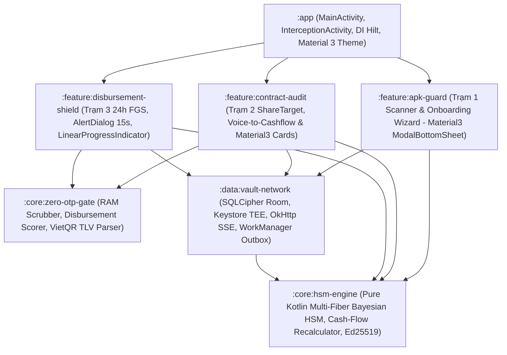

# SESSION 5 (v3.0 Production-First & `v0.dev` Edition) — Đặc Tả Android Native (Material 3), Kiến Trúc Sản Phẩm Thật Kèm `Sandbox Mode` & Giao Diện 100% Từ `v0.dev` + Components Có Sẵn

**Dự án:** **VayShield AI**  
**Vai trò đồng chủ trì Session 5:** Senior Android Systems Engineer • Principal Product UI/UX Architect • Senior Frontend Engineer • Accessibility Specialist • Fintech Ops Product Lead.

---

## 1. Nguyên Tắc Cốt Lõi: "Sản Phẩm Thật 100% Ngay Từ Đầu + Chế Độ `Sandbox Mode` Cho Giám Khảo" & "0% Tự Vẽ Giao Diện Thủ Công"

> [!IMPORTANT]
> **Hiệu chỉnh Kiến trúc Quan trọng:** Thay vì dựng một *"màn hình trình diễn giả lập (Demo Screen có khung điện thoại giả)"* dễ khiến Ban giám khảo hiểu lầm là bản mẫu thử (prototype), toàn bộ hệ thống được xây dựng là **Sản Phẩm Thực Tế (Production Web/PWA + Production B2B SaaS + Production Android App)** dùng được ngay ngoài đời thực từ giây đầu tiên. Chế độ **`Sandbox Mode`** được thiết kế giống hệt công tắc **`Test Mode` của Stripe Dashboard** — là một thanh công cụ bật/tắt gọn gàng giúp Giám khảo nạp dữ liệu mẫu hoặc bắn sự kiện giả lập giải ngân/cuộc gọi đi xuyên qua **chính giao diện và Backend thật của sản phẩm**!

### 1.1. Quy Tắc "Zero Custom Drawing" — Chỉ Dùng `v0.dev` & Hệ Sinh Thái Component Chuẩn Công Nghiệp

Đội ngũ kỹ thuật **tuyệt đối không tự vẽ tay** đồ thị Canvas/SVG, không tự viết CSS khung sườn, không tự code ô nhập tiền tệ hay bảng biểu thủ công. 100% giao diện được sinh từ **Vercel `v0.dev` (`npx shadcn@latest add ...`)** kết hợp các thư viện Production đã kiểm chứng:

| Nhu Cầu Hiển Thị Trên Sản Phẩm | Thư Viện / Component Có Sẵn Bắt Buộc Dùng (Không Tự Vẽ Tay!) | Lệnh Cài Đặt / Nguồn Chuẩn |
| :--- | :--- | :--- |
| **Khung bố cục, Thẻ cảnh báo, Nút, Tabs, Hộp thoại khóa** | **Shadcn UI + Radix UI Primitives** (`Card`, `Alert`, `AlertDialog`, `Badge`, `Button`, `Tabs`, `Sheet`, `Accordion`, `Progress`, `Skeleton`, `ResizablePanelGroup`) | Sinh trực tiếp từ **`v0.dev`** + `npx shadcn@latest init` |
| **Ngăn kéo Mobile mượt như App gốc (PWA)** | **`Vaul` (Shadcn `Drawer`)** — Vuốt đóng mở chuẩn vật lý iOS/Android có sẵn | `npx shadcn@latest add drawer` |
| **Kéo thả & Chọn 1–4 ảnh hợp đồng** | **`react-dropzone`** + ảnh xem trước bằng Shadcn `AspectRatio` & `ScrollArea` | `pnpm add react-dropzone` |
| **Ô sửa số tiền tự động tách dấu chấm `10.000.000`** | **`react-number-format` (`NumericFormat`)** bọc ngoài Shadcn `Input` | `pnpm add react-number-format` |
| **Biểu đồ Xoáy nợ 3 chu kỳ & KPI B2B Fintech** | **Shadcn Charts (`Recharts` có sẵn: `BarChart`, `AreaChart`, `ChartContainer`, `ChartTooltip`)** | `npx shadcn@latest add chart` |
| **Đồ thị Tài khoản Mồi `Pre-SIMO Mule Graph` (B2B)** | **`@xyflow/react` (React Flow)** + **`@dagrejs/dagre`** (tự động sắp xếp vị trí nút/cạnh đẹp mắt, có sẵn `MiniMap`, `Controls`, `Background`!) | `pnpm add @xyflow/react @dagrejs/dagre` |
| **Bảng danh sách Chiến dịch & Bộ lọc chuyên viên Ops** | **Shadcn `DataTable` (`@tanstack/react-table`)** + **`cmdk` (Shadcn `Command`)** tìm kiếm nhanh | `npx shadcn@latest add table command` |
| **Trang Tài liệu & Bắn thử B2B Webhook API sống** | **`@scalar/api-reference-react`** — Tự động đọc `/openapi.json` của FastAPI sinh ra giao diện thử API đẳng cấp quốc tế trong **5 dòng code**! | `pnpm add @scalar/api-reference-react` |
| **Chuông báo khẩn cấp & Thẻ Giải cứu 2 chiều** | **`Sonner` (Shadcn `Sonner` Rich Colors)** + Shadcn `Alert` nổi bật + **`lucide-react`** Icons | `npx shadcn@latest add sonner` |
| **Toàn bộ Giao diện App Android Native** | **100% Google Official `androidx.compose.material3`** (`Scaffold`, `ModalBottomSheet`, `ElevatedCard`, `CircularProgressIndicator`, `LinearProgressIndicator`, `AlertDialog`, `ListItem`) | `androidx.compose.material3:material3` |

---

## 2. Kiến Trúc Sản Phẩm Thật Kép & Cơ Chế `Sandbox Mode` Cho Ban Giám Khảo (`Next.js 15`)

### 2.1. Sơ Đồ Định Tuyến Sản Phẩm Thực Tế (Production Routes vs. Non-Intrusive Sandbox Overlay)

```mermaid
flowchart TB
    subgraph PROD_APPS["1. Sản Phẩm Thực Tế Hoạt Động Độc Lập Trực Tuyến (Dùng Thật Ngay Hôm Nay)"]
        B2C_HOME["`/` — Ứng Dụng Web/PWA Trợ Lý Người Đi Vay (Quét hợp đồng thật, Đọc miệng điều khoản, Quản lý Khiên 24h & Tạo QR Gia đình)"]
        FAM_APP["`/guardian` — Ứng Dụng PWA Người Thân Bảo Hộ (Nhận Web Push thật trên điện thoại con cái & Bấm Gửi Thẻ Giải Cứu 2 Chiều)"]
        B2B_OPS["`/workspace` — Nền Tảng SaaS Fintech Fraud & Trust Ops (Đồ thị React Flow Mule Graph, Duyệt Hồ sơ SIMO, Quản lý API Key)"]
        API_DOCS["`/developers` — Cổng Tích Hợp API Đối Tác (`@scalar/api-reference-react` kết nối sống với FastAPI OpenAPI)"]
    end

    subgraph SANDBOX_LAYER["2. Lớp Tiện Ích `Sandbox Mode` Tinh Gọn (Chỉ bật khi gạt công tắc `Test Mode` hoặc mở link `?sandbox=1`)"]
        SB_BAR["Top Banner Mỏng Màu Hổ Phách (Shadcn Badge + Switch: 'Đang bật Chế độ Dùng thử Giám khảo - Dữ liệu cô lập an toàn')"]
        SB_DRAWER["Shadcn `Sheet` Bên Phải ('Bộ Kích Hoạt Kịch Bản Thực Tế'): 1-Click nạp ảnh hợp đồng mẫu vào ô Upload thật, Giả lập Ngân hàng vừa giải ngân +20tr, Giả lập đang có cuộc gọi kẻ gian, Mở nhanh cửa sổ Người thân / B2B cạnh bên"]
    end

    SB_BAR --> SB_DRAWER
    SB_DRAWER -->|"Bắn sự kiện thật vào đúng Store & Backend API của sản phẩm chính"| PROD_APPS
```

**Tại sao thiết kế này thuyết phục tuyệt đối Ban Giám Khảo?**
1. Khi Giám khảo vào trang chủ `/`, họ nhìn thấy một **ứng dụng tài chính dân sinh sạch sẽ, hoàn chỉnh, chuyên nghiệp** (giống một sản phẩm thật đã ra mắt thị trường), có thể tải ngay ảnh hợp đồng trong máy của Giám khảo lên dùng thật mà không cần bất kỳ chế độ giả lập nào!
2. Khi Giám khảo muốn kiểm chứng nhanh **Trạm 3 (Sau giải ngân 24h + Đang nghe điện thoại)** và **Luồng Giải cứu Gia đình $\to$ Đồ thị B2B** ngay trên chiếc Laptop đang chấm bài (mà không thể tự đi vay ngân hàng thật 20 triệu lúc chấm thi!), Giám khảo chỉ cần mở ngăn kéo **`Sandbox Mode`** bấm nút kích hoạt sự kiện ngoại vi $\rightarrow$ **Chính giao diện sản phẩm thật** lập tức phản ứng, khóa bình tĩnh 15 giây, phát giọng nói Tiếng Việt và nhảy dữ liệu thật sang trang `/guardian` và `/workspace`! *(Ngoài ra trên thanh Sandbox có sẵn tùy chọn `Split-View` bằng Shadcn `ResizablePanelGroup` nếu Giám khảo muốn xem 2 màn hình sản phẩm thật đặt cạnh nhau trên 1 tab mà không có bất kỳ "vỏ điện thoại giả" nào!).*

---

### 2.2. Cấu Trúc Thư Mục `Next.js 15` Dựa Trên Components Có Sẵn (`web-portal/`)

```text
web-portal/
├── components.json                     # Cấu hình chuẩn Shadcn UI + Tailwind CSS + v0.dev Registry
├── public/
│   ├── sw.js                           # Service Worker xử lý W3C VAPID Web Push
│   ├── manifest.json                   # Cấu hình PWA chuẩn cho Người vay & Người thân
│   └── sandbox-samples/                # Ảnh hợp đồng/VietQR thực tế đã che PII để nạp nhanh trong Sandbox Mode
├── src/
│   ├── app/
│   │   ├── layout.tsx                  # Root Layout + Sonner Toaster + SandboxModeProvider + SandboxFloatingTrigger
│   │   ├── page.tsx                    # SẢN PHẨM THẬT B2C: Trợ lý Kiểm toán Hợp đồng, Khiên 24h & Ghép đôi Gia đình
│   │   ├── triage/page.tsx             # SẢN PHẨM THẬT B2C: Phác đồ Cấp cứu 60 Phút Vàng (Hotline Ngân hàng + Xuất PDF Công an)
│   │   ├── guardian/page.tsx           # SẢN PHẨM THẬT PWA NGƯỜI THÂN: Ghép đôi QR, Trạng thái Bảo vệ & Nút Giải cứu 2 Chiều
│   │   ├── workspace/page.tsx          # SẢN PHẨM THẬT B2B SAAS: Fintech Fraud Ops Dashboard (React Flow + DataTable + Copilot)
│   │   └── developers/page.tsx         # SẢN PHẨM THẬT B2B DOCS: Scalar Interactive OpenAPI Reference cho đối tác Fintech
│   ├── components/
│   │   ├── ui/                         # 100% components cài sẵn từ `npx shadcn@latest add ...` (KHÔNG SỬA TAY)
│   │   ├── v0-blocks/                  # Các khối giao diện sinh từ `v0.dev` đã gắn Props dữ liệu thật:
│   │   │   ├── contract-audit-panel.tsx      # Dropzone + SSE Stepper + NumericFormat Strip + Verdict Alert + Recharts BarChart
│   │   │   ├── voice-terms-drawer.tsx        # Vaul Drawer đọc miệng 3 con số khi app vay chặn chụp màn hình
│   │   │   ├── shield-interception-modal.tsx # Radix AlertDialog khóa 15s + Progress + RadioGroup bất đối xứng + Rescue Alert
│   │   │   ├── family-guardian-card.tsx      # Giao diện SOS người thân + nút gửi Rescue Card 2 chiều
│   │   │   ├── mule-network-flow.tsx         # `@xyflow/react` + `dagre` auto-layout (0 dòng code tự vẽ đồ thị!)
│   │   │   └── simo-copilot-sheet.tsx        # Shadcn Sheet hiển thị hồ sơ SIMO & bản tin cảnh báo do AI sinh
│   │   └── sandbox/
│   │       └── judge-sandbox-sheet.tsx       # Ngăn kéo Shadcn Sheet mô hình Stripe Test Mode + tùy chọn ResizablePanelGroup
│   ├── workers/
│   │   └── image-sanitizer.worker.ts   # Nén ảnh WebP <=1280px & chuyển đổi ảnh iPhone .HEIC tự động
│   ├── hooks/
│   │   ├── useSseContractAudit.ts      # Kết nối POST /api/v1/audits/contract-stream
│   │   ├── useGuardianWebSocket.ts     # WebSocket 2 chiều + ACK + BroadcastChannel đồng bộ tab
│   │   └── useVietnameseVoice.ts       # Web Speech API + Server TTS Fallback cho MacBook Giám khảo
│   └── stores/
│       └── useVayShieldStore.ts        # Zustand quản lý phiên Live / Sandbox tách biệt sạch sẽ
```

---

### 2.3. Bộ 5 Prompt Chuẩn Hóa Cho `v0.dev` (Copy-Paste Vào `v0.dev` Để Sinh Giao Diện Đẳng Cấp Ngay Lập Tức)

Để đảm bảo giao diện đồng nhất, hiện đại, chuẩn Fintech hàng đầu mà không tốn công căn chỉnh CSS thủ công, đội Frontend sử dụng trực tiếp 5 Prompt thiết kế cho `v0.dev` sau:

1. **`v0.dev` Prompt 1 — Trang Chính Trợ Lý Người Vay (`/` — Theme `Sunlight High-Contrast Light`)**:
   > *"Build a clean, high-contrast mobile-first Vietnamese consumer fintech protection web app using Next.js App Router, Tailwind CSS, Shadcn UI (`Card`, `Badge`, `Button`, `Alert`, `Progress`, `Tabs`, `Input`), and `lucide-react` icons. High readability WCAG AAA light theme (`slate-950` text on white/slate-50 background, large 18px base typography for factory workers). Include: (1) Top status bar showing 'Khiên Bảo Vệ Vay: Đang Bật' with a subtle 'Sandbox Mode' switch; (2) Multi-image contract upload dropzone card with a secondary prominent button 'App chặn chụp ảnh? Bấm đọc miệng 3 con số'; (3) 5-step horizontal/vertical SSE analysis progress indicator; (4) Editable 3-column number verification strip ('Thực nhận', 'Tổng phải trả', 'Kỳ hạn ngày'); (5) Traffic-light Verdict Card (`Alert` destructive/warning/default) translating hidden interest into 'Số ngày công lao động bị mất' plus a Shadcn Recharts `BarChart` comparing debt rollover after 30, 60, 90 days."*
2. **`v0.dev` Prompt 2 — Hộp Thoại Khóa Bình Tĩnh 15 Giây & Giải Cứu 2 Chiều (`shield-interception-modal.tsx`)**:
   > *"Create a high-urgency scam interception modal using Shadcn `AlertDialog`, `Progress`, `Badge`, `Button`, and `Alert` (no custom CSS animations). Header shows a red destructive badge 'Phát hiện đang có cuộc gọi trực tiếp ngay sau khi nhận giải ngân' and an audio wave indicator with 'Nghe lại giọng đọc cảnh báo'. Middle section shows a 15-second linear calm-down `Progress` bar, followed by 3 large full-width touch-friendly selection buttons asking the transaction purpose (non-confrontational elicitation) and a push-to-talk microphone button. Include a conditional high-visibility green `Alert` banner at the top for 'Tin nhắn khẩn từ Người thân bảo hộ' when a bidirectional family rescue message arrives."*
3. **`v0.dev` Prompt 3 — Ứng Dụng PWA Người Thân Bảo Hộ (`/guardian`)**:
   > *"Build a mobile-first Family Safety Guardian PWA screen using Shadcn UI (`Card`, `Badge`, `Button`, `Alert`, `Input`) and `lucide-react`. Include two states via Tabs or state prop: (1) Peaceful state showing 'Thiết bị của Mẹ đang an toàn — Bảo mật số tiền riêng tư 100%' with Web Push status badge; (2) Emergency Red SOS state with two massive 64px-height action buttons: 'Gửi Thẻ Chặn Giao Dịch Lên Màn Hình Của Mẹ Ngay' and 'Gọi Điện Thoại Trực Tiếp'."*
4. **`v0.dev` Prompt 4 — Bàn Làm Việc B2B Fintech Fraud & Trust Ops (`/workspace` — Theme `Tactical Dark`)**:
   > *"Build an enterprise dark-mode Fintech Fraud Operations Workspace dashboard using Next.js, Shadcn UI (`Sidebar`, `Card`, `Tabs`, `Table`, `Badge`, `Button`, `Sheet`), Shadcn `ChartContainer` (`AreaChart`), and a dedicated container slot for `@xyflow/react` network graph. Top row: 4 KPI cards with `tabular-nums` monospace metrics (Active 24h Shields, Blocked APP Fraud VND, Estimated NPL Saved, Pre-SIMO Mule Accounts). Main split layout: Left side interactive Mule Account Network container + Campaign Clusters `DataTable`; Right side collapsible Shadcn `Sheet` for 'AI Fraud Copilot' displaying auto-generated SIMO regulatory report JSON/summary and one-click customer advisory approval."*
5. **`v0.dev` Prompt 5 — Thanh Công Cụ `Sandbox Mode` Kiểu Stripe Cho Giám Khảo (`judge-sandbox-sheet.tsx`)**:
   > *"Create a sleek, non-intrusive developer/judge 'Sandbox Mode' top banner and slide-over `Sheet` using Shadcn UI (`Switch`, `Badge`, `Sheet`, `Button`, `Separator`, `Select`). Allow judges to: (1) Load 1 of 4 real anonymized scam contract/VietQR samples directly into the live scanner with 1 click; (2) Trigger simulated external hardware/bank events ('Ngân hàng giải ngân +20.000.000đ', 'Kẻ gian đang giữ cuộc gọi Zalo', 'Mở ứng dụng Ngân hàng') against the real backend session; (3) Toggle an optional side-by-side `ResizablePanelGroup` view to observe Borrower UI, Family Guardian UI, and Fintech Ops Workspace reacting simultaneously in real time."*

---

## 3. Kiến Trúc Nội Bộ Ứng Dụng Android Native (`Kotlin + Jetpack Compose Material 3`, API 26 $\to$ 35)

*(Trên Android Native, toàn bộ giao diện sử dụng 100% thư viện chính thức `androidx.compose.material3` của Google — không tự vẽ Canvas thủ công).*

### 3.1. Cấu Trúc Đa Module Clean Architecture



---

### 3.2. Đặc Tả Chính Xác `AndroidManifest.xml` Chuẩn Bảo Mật Android 14 / 15 (API 34–35)

```xml
<manifest xmlns:android="http://schemas.android.com/apk/res/android">

    <uses-permission android:name="android.permission.INTERNET" />
    <uses-permission android:name="android.permission.ACCESS_NETWORK_STATE" />
    <uses-permission android:name="android.permission.POST_NOTIFICATIONS" />
    <uses-permission android:name="android.permission.VIBRATE" />
    <uses-permission android:name="android.permission.RECORD_AUDIO" /> <!-- Chỉ xin khi bấm nút Đọc miệng -->
    <uses-permission android:name="android.permission.QUERY_ALL_PACKAGES" />
    <uses-permission android:name="android.permission.PACKAGE_USAGE_STATS" />
    <uses-permission android:name="android.permission.FOREGROUND_SERVICE" />
    <uses-permission android:name="android.permission.FOREGROUND_SERVICE_SPECIAL_USE" />
    <uses-permission android:name="android.permission.USE_FULL_SCREEN_INTENT" />
    <uses-permission android:name="android.permission.RECEIVE_BOOT_COMPLETED" />

    <application
        android:name=".VayShieldApp"
        android:allowBackup="false"
        android:fullBackupContent="false"
        android:dataExtractionRules="@xml/zero_cloud_backup_rules">

        <!-- Trạm 1: Lắng nghe cài đặt ứng dụng mới -->
        <receiver android:name=".apkguard.PackageInstallReceiver" android:exported="true">
            <intent-filter>
                <action android:name="android.intent.action.PACKAGE_ADDED" />
                <data android:scheme="package" />
            </intent-filter>
        </receiver>

        <!-- Trạm 2: Nhận trực tiếp 1-4 ảnh chia sẻ từ Zalo / Messenger / Thư viện ảnh -->
        <activity android:name=".contract.ContractShareAuditActivity" android:exported="true">
            <intent-filter>
                <action android:name="android.intent.action.SEND" />
                <action android:name="android.intent.action.SEND_MULTIPLE" />
                <category android:name="android.intent.category.DEFAULT" />
                <data android:mimeType="image/*" />
            </intent-filter>
        </activity>

        <!-- Trạm 3A: Bộ lọc thông báo biến động giải ngân Zero-OTP -->
        <service
            android:name=".shield.ZeroOtpNotificationGateService"
            android:exported="true"
            android:permission="android.permission.BIND_NOTIFICATION_LISTENER_SERVICE">
            <intent-filter>
                <action android:name="android.service.notification.NotificationListenerService" />
            </intent-filter>
        </service>

        <!-- Trạm 3B: Dịch vụ Khiên 24h (Chỉ chạy khi S4_SHIELD_ARMED_24H kích hoạt) -->
        <service
            android:name=".shield.DisbursementShieldForegroundService"
            android:exported="false"
            android:foregroundServiceType="specialUse">
            <property
                android:name="android.app.PROPERTY_SPECIAL_USE_FGS_SUBTYPE"
                android:value="time_bounded_24h_post_loan_disbursement_anti_scam_shield" />
        </service>

        <!-- Trạm 3C: Màn hình Chắn Độc Lập Khóa Bình Tĩnh 15 Giây (Bật cứng FLAG_SECURE trong onCreate) -->
        <activity
            android:name=".shield.InterceptionActivity"
            android:exported="false"
            android:launchMode="singleTop"
            android:excludeFromRecents="true"
            android:showOnLockScreen="true"
            android:turnScreenOn="true" />

        <!-- Phục hồi Khiên 24h sau khi sập nguồn khởi động lại hoặc cập nhật phiên bản mới -->
        <receiver android:name=".shield.BootAndUpdateRecoveryReceiver" android:exported="true">
            <intent-filter>
                <action android:name="android.intent.action.BOOT_COMPLETED" />
                <action android:name="android.intent.action.MY_PACKAGE_REPLACED" />
            </intent-filter>
        </receiver>

        <!-- Ô Cài Đặt Nhanh 1 Chạm trên Thanh Trạng Thái ("Soi Vay Khẩn") -->
        <service
            android:name=".quicktile.VayShieldQuickTileService"
            android:exported="true"
            android:icon="@drawable/ic_shield_tile"
            android:label="Soi Vay Khẩn"
            android:permission="android.permission.BIND_QUICK_SETTINGS_TILE">
            <intent-filter>
                <action android:name="android.service.quicksettings.action.QS_TILE" />
            </intent-filter>
        </service>
    </application>
</manifest>
```

### 3.3. Cơ Chế Thăm Dò Thích Nghi Tiết Kiệm Pin `< 1.2% / 24h` & Ba Chốt Chặn Cửa Sổ

| Trạng Thái Màn Hình (`PowerManager`) | Trạng Thái Đàm Thoại (`AudioManager.OnModeChangedListener`) | Chu Kỳ Quét `UsageStatsManager` | Mức Tiêu Thụ CPU / Pin |
| :--- | :--- | :---: | :--- |
| **Màn hình TẮT (`ACTION_SCREEN_OFF`)** | Bất kỳ | **`0 Hz` (Dừng hoàn toàn Ticker)** | **`0.00% CPU`** |
| **Màn hình BẬT (`ACTION_SCREEN_ON`)** | Không có cuộc gọi (`MODE_NORMAL`) | **`1.200 ms / lần`** | Rất thấp (`< 0.4% / 24h`) |
| **Màn hình BẬT** | Đang đàm thoại hoặc vừa cúp máy $\le 180\text{s}$ (`IN_CALL` / `IN_COMM`) | **`300 ms / lần` (Phản xạ Đỏ)** | Tức thời (`Độ trễ chặn < 350ms`) |

1. **Làm Mù Chia Sẻ Màn Hình Kẻ Gian (`FLAG_SECURE`)**: Bật `window.setFlags(FLAG_SECURE, FLAG_SECURE)` trên `InterceptionActivity` để phía kẻ gian đang xem Zalo Screen Share / AnyDesk chỉ thấy màn hình đen tuyền.
2. **Khóa Vuốt Cạnh Thoát Quán Tính (`BackHandler`)**: Chặn vuốt cạnh trái Android 14/15 trong suốt 15 giây đếm ngược của Material 3 `LinearProgressIndicator`.
3. **Đếm Ngược Theo Đồng Hồ Đơn Điệu (`SystemClock.elapsedRealtime()`)**: Miễn nhiễm hoàn toàn với lỗi tắt hiệu ứng chuyển động khi bật Tiết kiệm Pin.

---

## 4. Danh Mục 26 Edge Cases Chuyên Sâu Của Android OS, iOS PWA, Component UI & Trình Duyệt (`EC-UX01` $\to$ `EC-UX26`)

| Mã | Phân Nhóm Thiết Bị / UX | Tình Huống Biên Thực Tế (Mobile OS, Component & Browser Edge Case) | Cơ Chế Hóa Giải Bằng Thư Viện Chuẩn Có Sẵn |
| :--- | :--- | :--- | :--- |
| **`EC-UX01`** | **Android Font Scale** | **Người lao động lớn tuổi chỉnh cỡ chữ hệ thống Android lên `200%` (`fontScale = 2.0f`)** làm vỡ khung thẻ cảnh báo. | Giới hạn trần `Density(fontScale = current.coerceAtMost(1.35f))` cho bảng số liệu, dùng Material 3 `Scaffold(bottomBar = ...)` ghim nút hành động cố định ở đáy! |
| **`EC-UX02`** | **Android 14/15 Back** | **Thao tác vuốt cạnh màn hình (`Predictive Back Gesture`) theo phản xạ giật mình** làm đóng mất màn hình Khóa bình tĩnh 15 giây! | Dùng `BackHandler(enabled = cooldownSec > 0)` có sẵn của `androidx.activity.compose`; trên Web dùng Radix `AlertDialog` chặn `onEscapeKeyDown`! |
| **`EC-UX03`** | **Battery Saver Animation** | **Chế độ Siêu Tiết Kiệm Pin tắt toàn bộ hiệu ứng chuyển động (`ANIMATOR_DURATION_SCALE = 0f`)** làm nhảy vọt thanh tiến trình! | Truyền trực tiếp biến `progress = { remainingMs / 15000f }` tính từ `SystemClock.elapsedRealtime()` vào Material 3 `LinearProgressIndicator` và Shadcn `Progress`! |
| **`EC-UX04`** | **Zalo / FB WebView** | **Người dùng bấm mở link sản phẩm trực tiếp từ khung chat Zalo / Messenger (`In-App WebView`)** bị chặn `Web Push` hoặc Mic! | Phát hiện `User-Agent` (`Zalo`, `FBAN`): bật Shadcn `Alert` có nút mở bung sang Chrome/Safari 1 chạm, đồng thời tự động chạy Fallback WebSocket + Server TTS ngay trong WebView! |
| **`EC-UX05`** | **iOS Safari Web Push** | **Trên iPhone (iOS 16.4–18+), Apple chặn `Notification.requestPermission()` nếu chưa thêm PWA vào Màn hình chính**! | Kiểm tra `isIos && !window.navigator.standalone`: bật `Vaul Drawer` hướng dẫn 2 bước *"Chia sẻ $\to$ Thêm vào MH chính"* kèm ô đăng ký SMS/Email dự phòng! |
| **`EC-UX06`** | **iPhone `.HEIC` Upload** | **Giám khảo kéo thả ảnh chụp từ iPhone (`.HEIC` / `.HEIF`) vào trình duyệt Chrome trên Windows** không hiển thị được! | Dùng gói có sẵn `heic2any` (Dynamic Import trong Worker) tự động chuyển về `WebP` trước khi đưa vào `react-dropzone` preview! |
| **`EC-UX07`** | **Mù Màu Đỏ - Xanh** | **Người dùng mù màu Đỏ - Lục (`Deuteranopia`, ~8% nam giới)** khó phân biệt màu thẻ cảnh báo. | Dùng bộ icon phân biệt hình học có sẵn của **`lucide-react`** (`OctagonAlert` cho Đỏ, `TriangleAlert` cho Cam, `ShieldCheck` cho Xanh) kèm nhãn chữ tường minh trên Shadcn `Badge`! |
| **`EC-UX08`** | **Màn Hình Khóa & Cuộc Gọi** | **Điện thoại tắt tối màn hình khi áp lên tai nghe điện thoại**, hạ máy xuống mở ngay App Ngân hàng. | `InterceptionActivity` bật cờ chuẩn Android `setShowWhenLocked(true)` + `setTurnScreenOn(true)`. |
| **`EC-UX09`** | **Notification Listener Chết** | **Oppo/Vivo ngắt kết nối ngầm `NotificationListenerService` sau khi dọn RAM cực đoan**. | Gọi hàm chuẩn HĐH `NotificationListenerService.requestRebind(ComponentName)` ngay trong `onListenerDisconnected()`. |
| **`EC-UX10`** | **Bàn Phím Che Khuất** | **Bàn phím số bật lên che khuất nút `[Tính lại ngay]` khi sửa số tiền trên điện thoại nhỏ**. | Trên Android dùng `Modifier.imePadding()`; trên Web dùng **`Vaul Drawer`** có cơ chế tự đẩy khung nhập lên trên bàn phím ảo iOS/Android sẵn có! |
| **`EC-UX11`** | **Tay Ướt / Chạm Đôi** | **Công nhân bấm đúp liên tục 3 lần vào nút Quét Hợp Đồng hoặc Báo Người Thân** gây gửi trùng request. | Gắn trạng thái `disabled={isPending}` có sẵn của Shadcn `Button` kèm icon xoay `Loader2` (`animate-spin`) của `lucide-react` ngay mili-giây bấm đầu tiên. |
| **`EC-UX12`** | **Xoay Ngang Màn Hình** | **Xoay ngang điện thoại (`Portrait -> Landscape`) lúc đang chạy SSE làm Activity khởi tạo lại từ đầu**. | Giữ luồng SSE và trạng thái trong `HiltViewModel` (`viewModelScope`) sống xuyên qua Configuration Change; khóa `portrait` cho `InterceptionActivity`. |
| **`EC-UX13`** | **EXIF Xoay Ngược Ảnh** | **Ảnh chụp camera điện thoại chứa cờ `EXIF Orientation = 6`** bị nằm ngang sau khi nén. | Gọi API chuẩn trình duyệt `createImageBitmap(file, { imageOrientation: 'from-image' })` xoay chuẩn chiều đứng tự động trước khi xuất `WebP`. |
| **`EC-UX14`** | **Tab Trình Duyệt Ngủ Đông** | **Tab `/guardian` hoặc `/workspace` bị ẩn dưới tab khác quá 5 phút bị Chrome đóng băng bộ đếm JS**. | Chạy kết nối WebSocket giữ nhịp trong `Web Worker` và lắng nghe `visibilitychange` đồng bộ lại ngay khi người dùng mở lại tab. |
| **`EC-UX15`** | **Chính Sách Chặn Auto-Play** | **Trình duyệt chặn `audio.play()` tự động nếu trang chưa có tương tác chuột**. | Mở khóa sẵn `HTMLAudioElement` ngay ở thao tác chọn file / gạt nút đầu tiên của người dùng và hiện nút phát lại âm thanh nổi bật trên `Sonner` / `Alert`. |
| **`EC-UX16`** | **Trình Đọc Màn Hình TalkBack** | **Người khiếm thị bật `TalkBack` / Screen Reader bị hai giọng đọc đè lên nhau**. | Nhờ dùng **Radix UI / Shadcn UI & Material 3 chuẩn**, toàn bộ thẻ `role="alertdialog"` và `aria-live="assertive"` đã tương thích sẵn với trình đọc màn hình; tự tắt TTS riêng nếu phát hiện `TouchExploration` đang bật! |
| **`EC-UX17`** | **Android 14 Partial Photo** | **Người dùng chọn *"Chỉ cho phép truy cập một số ảnh đã chọn"* trên Android 14/15**. | Dùng component có sẵn **`ActivityResultContracts.PickMultipleVisualMedia(4)`** của Google Jetpack không cần xin quyền kho ảnh nhạy cảm! |
| **`EC-UX18`** | **Dán Ảnh Từ Clipboard** | **Người dùng trên Web bấm `Ctrl+V / Cmd+V` dán thẳng ảnh chụp màn hình hợp đồng vào trang chủ `/`**. | Gắn listener `onPaste` toàn trang đẩy thẳng `File` từ Clipboard vào hook của `react-dropzone` không cần lưu file trung gian! |
| **`EC-UX19`** | **Chia Đôi Màn Hình Linh Hoạt** | **Giám khảo muốn xem song song giao diện Người vay và Bàn làm việc Fintech Ops trên màn hình Laptop 13 inch**. | Sử dụng component có sẵn **Shadcn `ResizablePanelGroup` (`react-resizable-panels`)** cho phép Giám khảo kéo thanh chia tỷ lệ mượt mà hoặc gập gọn thành `Tabs` trên màn hình hẹp! |
| **`EC-UX20`** | **Quyền `FullScreenIntent` API 34** | **Android 14+ tắt mặc định `USE_FULL_SCREEN_INTENT` cho ứng dụng cài mới**. | Kiểm tra `canUseFullScreenIntent()`, hướng dẫn bật trong Wizard, và luôn chạy song song `Heads-Up Notification + TTS` không phụ thuộc quyền này. |
| **`EC-UX21`** | **Gói Cài Đặt Split APKs** | **Ứng dụng vay tải từ Store dưới dạng `App Bundle / Split APKs` nhiều tệp**. | Dùng `PackageManager.getPackageInfo` ở mức gói hợp nhất để đọc đầy đủ quyền và chữ ký SHA-256. |
| **`EC-UX22`** | **Xung Đột Mic Khi Đang Gọi** | **Khi đang trong cuộc gọi (`MODE_IN_CALL`), hệ điều hành giữ độc quyền phần cứng Mic làm STT không thu được tiếng**. | Tự động vô hiệu hóa nút Mic khi phát hiện `AudioMode != MODE_NORMAL` và làm nổi bật 3 nút chọn lớn `Button` của Material 3 / Shadcn để chạm trả lời ngay! |
| **`EC-UX23`** | **Mạng Yếu Khi Upload Ảnh** | **Đứt mạng 4G giữa chừng khi đang gửi 3 ảnh hợp đồng**. | Giữ nguyên mảng file đã chọn trong state của `react-dropzone` kèm nút `[Thử lại]` trên `Sonner` toast; quá 5 giây đề xuất bật chế độ OCR cục bộ `MLKit`! |
| **`EC-UX24`** | **Đồ Thị B2B Nhiều Nút** | **Đồ thị tài khoản mồi B2B có hàng trăm nút nếu tự vẽ sẽ lag trình duyệt**. | Dùng **`@xyflow/react` (React Flow)** bật sẵn thuộc tính `onlyRenderVisibleElements={true}` + gom nhóm theo `dagre` layout đảm bảo mượt `60fps` không tốn 1 giờ tự tối ưu đồ họa! |
| **`EC-UX25`** | **Chống Lộ Ảnh Đa Nhiệm** | **Ảnh hợp đồng vay hiện công khai khi mở trình chuyển đổi ứng dụng (`App Switcher`)**. | Cờ `FLAG_SECURE` và `excludeFromRecents="true"` tự động che trắng màn hình thu nhỏ trong danh sách đa nhiệm Android. |
| **`EC-UX26`** | **Gõ Nhầm Số `0` Tiền Tệ** | **Người dùng sửa số tiền vay `10.000.000` dễ gõ thừa/thiếu số `0`**. | Component có sẵn **`NumericFormat` (`react-number-format`)** tự động điền dấu chấm phân tách hàng nghìn ngay khi gõ kèm dòng chữ phụ đọc số bằng tiếng Việt (*"Mười triệu đồng"*) bên dưới! |
