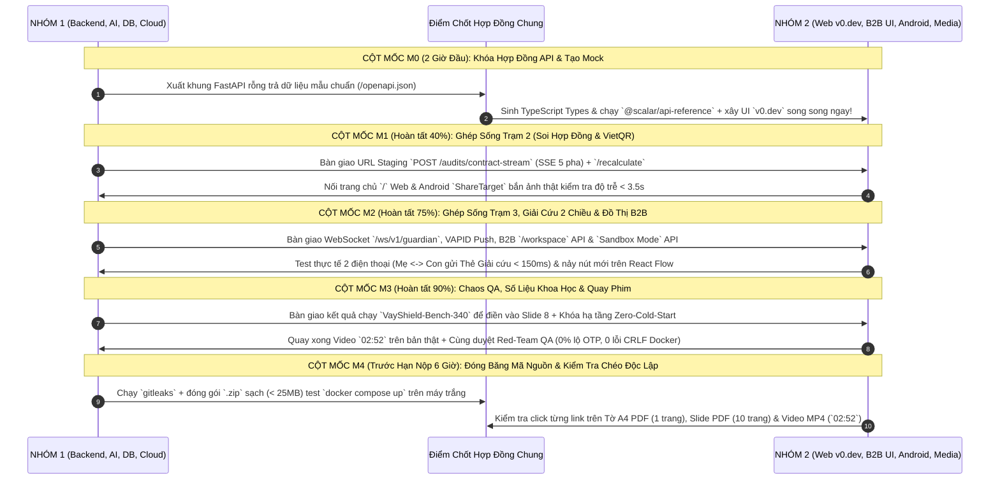

# KẾ HOẠCH PHÂN CHIA NHIỆM VỤ CHO 2 NHÓM (50% – 50% SONG SONG KHÔNG XUNG ĐỘT CODE)

**Dự án:** **VayShield AI** — Sản phẩm Thật Trực tuyến (B2C Web/PWA + B2B Fintech SaaS + Android Native) kèm `Sandbox Mode`  
**Mục tiêu điều phối:** Chia đôi khối lượng toàn dự án thành **2 Nhóm cân bằng đúng 50% – 50%**, làm việc song song ngay từ giờ đầu tiên mà **không phải ngồi chờ nhau (`Zero Blocking`)** và **không chạm chung file gây lỗi gộp nhánh (`Zero Git Merge Conflict`)**.

---

## 1. Chiến Lược Phân Tách Kiến Trúc Cho 2 Nhóm (Clean Architectural Split)

> [!IMPORTANT]
> **Nguyên tắc vàng để 2 nhóm chạy song song tốc độ gấp đôi:** Dành đúng **2 giờ đầu tiên (`Cột mốc M0`)** để khóa cứng file hợp đồng `openapi.json` + cấu trúc JSON của 5 sự kiện SSE + khung tin WebSocket (đã có sẵn 100% trong **File 4 — Mục 4**). Ngay sau giờ thứ 2, Nhóm 2 dùng Mock JSON/MSW để lắp ráp toàn bộ giao diện `v0.dev` + App Android, trong khi Nhóm 1 xây dựng toàn bộ Lõi Toán học, AI, Database và Cloud thật!

### Sơ Đồ Phân Quyền Sở Hữu Thư Mục Độc Lập (`Monorepo CODEOWNERS`)

```mermaid
flowchart LR
    subgraph CONTRACT["Hợp Đồng Chung Khóa Ở Giờ Thứ 2 (Shared Read-Only Contract)"]
        SPEC["contracts/openapi.yaml + sse-events.schema.json + ws-protocol.json"]
    end

    subgraph GROUP1["NHÓM 1 (50% Khối lượng): Core Backend, Neuro-Symbolic AI, Data & Cloud SRE"]
        G1_BE["/backend (FastAPI, Brent-XIRR Solver, 9-Verdict Legal Kernel, SSE, WS Hub)"]
        G1_AI["/backend/ai_pipeline (Vision Sanitizer, VietQR TLV, 10-Axis Ontology, GraphRAG, Copilot)"]
        G1_DB["/backend/migrations (PostgreSQL 16 + pgvector + RLS + Hash-Chain + Redis Lua)"]
        G1_BENCH["/benchmark-dataset (VayShield-Bench-340 + Script chạy số liệu thực nghiệm Slide 8)"]
        G1_INFRA["/infra & docker-compose.yml (Cloud Run / Railway Zero-Cold-Start + VIP Quota)"]
    end

    subgraph GROUP2["NHÓM 2 (50% Khối lượng): Sản Phẩm Web/B2B (`v0.dev`), Android Native & Hồ Sơ Thi Đấu"]
        G2_WEB["/web-portal (Next.js 15: `/` B2C App, `/guardian` PWA, `/triage`, `/workspace` B2B SaaS, `/developers`)"]
        G2_SB["/web-portal/src/components/sandbox (Công tắc `Sandbox Mode` kiểu Stripe + Resizable Split-View)"]
        G2_AND["/android-app (Kotlin + Compose Material 3: Trạm 1 APK, Trạm 2 Share/QS-Tile, Trạm 3 24h Shield)"]
        G2_MEDIA["/submission-docs (Thiết kế PDF 10 Slide khóa cứng, Quay dựng Video `02:52`, Tờ A4 Hướng dẫn)"]
    end

    CONTRACT --> GROUP1
    CONTRACT --> GROUP2
    GROUP1 <-->|"Ghép nối API sống tại Cột mốc M2"| GROUP2
```

*(Lưu ý linh hoạt: Nếu cả 2 nhóm đều gồm các thành viên Full-stack muốn chia theo chiều dọc tính năng thay vì chiều ngang Backend/Client, xem thêm **Phương án Chia Dọc Thay Thế** ở Mục 5 cuối tài liệu này).*

---

## 2. Chi Tiết 12 Gói Công Việc Của NHÓM 1 (`Core Engine, AI, Database & Cloud Track` — 50%)

**Thư mục làm việc độc quyền:** `/backend/`, `/benchmark-dataset/`, `/infra/`, `docker-compose.yml`.

| Mã Task | Tên Hạng Mục Công Việc (Work Package) | Tham Chiếu Đặc Tả (Đọc Đúng Mục Này Để Code) | Đầu Ra Bàn Giao & Tiêu Chí Hoàn Thành (Definition of Done) | Tỷ Trọng |
| :--- | :--- | :--- | :--- | :---: |
| **`WP1-01`** | **Khởi tạo PostgreSQL 16 + `pgvector` + `pg_trgm` + RLS + Hash-Chain** | **File 4** — Mục 2.1, 2.2 | Chạy sạch file SQL DDL 10 bảng, tạo HNSW/GIN Index, Trigger chống xóa `tamper_evident_audit_chain` và chính sách `RLS` cô lập đối tác B2B. | **5%** |
| **`WP1-02`** | **Nạp Dữ liệu Hạt giống Chuẩn (`Seed Registry & Legal Corpus`)** | **File 1** — Mục 1.2 **File 3** — Mục 5.1 **File 6** — `EC-OPS16` | Nạp danh sách 16 Công ty Tài chính cấp phép + Ngân hàng + P2P Sandbox (kèm `packageName`, hotline thật), các điều khoản BLDS 468 / BLHS 201 / NĐ 94/2025 / Luật TCTD 2024 và 3 cụm Mule lịch sử mẫu. | **4%** |
| **`WP1-03`** | **Lập trình `Deterministic Financial & Interval Kernel` + Unit Tests** | **File 2** — Mục 4.1 $\to$ 4.4 | Code hoàn chỉnh `solve_vn_legal_apr_365()`, `solve_ear_xirr()`, `solve_apr_interval_bounds()`, `MIRR`, quy đổi Ngày công lao động, mô phỏng xoáy nợ 3 kỳ và Ma trận 9 mã phán quyết. Pass 35 `pytest` cases (`<1ms`). | **6%** |
| **`WP1-04`** | **Tiền xử lý Thị giác Đối kháng & Giải mã Cứng `EMVCo VietQR`** | **File 3** — Mục 2.1 & `EC-AI01..06` | Hàm khử chữ tàng hình (nhận biết Light/Dark Mode), tách kênh mộc đỏ HSV, cắt lát ảnh cuộn dài và bộ giải mã TLV VietQR (`Tag 38` BIN/STK + phân biệt bong bóng chat Trái/Phải). | **5%** |
| **`WP1-05`** | **Đường ống Vision LLM Đa ảnh + `Conformal Escalation` + `Voice-to-Cashflow`** | **File 3** — Mục 1.2, 1.3, 2.2, 2.3, 2.4 | Tích hợp `Gemini 2.5 Flash` (Strict Pydantic Schema) + tự động Crop ROI gọi `Gemini 2.5 Pro` khi bất định + bộ chuẩn hóa từ lóng tiền tệ (*"củ, chai, xị"*) cho luồng đọc miệng. | **6%** |
| **`WP1-06`** | **API Trạm 1 & Trạm 2 (`Zero-Idle-Connection SSE Stream` + Recalculate)** | **File 4** — Mục 4.1, 4.2(A), `EC-DB01`, `EC-DB22` | Xây dựng `POST /audits/apk-verify`, `POST /audits/contract-stream` (phát 5 pha SSE + ping `2.5s` không giữ kết nối DB Pool) và `POST /audits/{id}/recalculate` (`<15ms`, 0 tốn token). | **5%** |
| **`WP1-07`** | **Redis 7 Lua `Bayesian HSM` + Chống Chia nhỏ Giao dịch (`Anti-Smurfing`)** | **File 2** — Mục 2.1, 2.2 **File 4** — Mục 3.1, 3.2 | Cài đặt máy trạng thái đa phiên `Multi-Fiber Semilattice`, kịch bản nguyên tử `atomic_smurf_and_risk_eval.lua` và khóa chống trùng lặp `Idempotency`. | **4%** |
| **`WP1-08`** | **Bộ phân loại 10 Trục Thao túng Trạm 3 & WebSocket Hub Giải cứu 2 Chiều** | **File 3** — Mục 3.2, 3.3 **File 4** — Mục 4.2(C) | Xây dựng `POST /shield/evaluate-response` (10 trục `C1–C10`), `GET /ws/v1/guardian` (One-Time Ticket), chuỗi leo thang `WS -> VAPID Push -> SMS/Email` sau 10s không có `ACK`, và `POST /family/send-rescue-card` (`<150ms`). | **5%** |
| **`WP1-09`** | **Đồ thị `Pre-SIMO Mule Graph` (Gồm `Dynamic VA`) + B2B Webhook & Copilot** | **File 3** — Mục 5.2 **File 4** — Mục 4.2(B), `EC-DB02` | Xây dựng `POST /b2b/disbursement-shield` (xác thực `HMAC-SHA256`), gom cụm `va_prefix_hmac` + `Huber-Medoid`, API xuất hồ sơ SIMO và API `POST /triage/golden-hour-dossier` + `/tts/synthesize-vi`. | **4%** |
| **`WP1-10`** | **Hỗ trợ Phân vùng `Sandbox Mode` Trên Backend & Bảo vệ Quota VIP** | **File 4** — `EC-DB16` **File 6** — Mục 1.2 | Tách biệt sạch sẽ dữ liệu có `sandbox_namespace` khỏi dữ liệu `live`, cài đặt endpoint kích hoạt sự kiện ngoại vi `/sandbox/simulate-event` và cụm khóa `GEMINI_VIP_KEYS` riêng cho link Giám khảo. | **2%** |
| **`WP1-11`** | **Xây dựng `VayShield-Bench-340` & Chạy 3 Thí nghiệm Đối chứng (Ablation)** | **File 3** — Mục 6.1, 6.2 | Tạo bộ test tự động chạy kiểm định thực nghiệm xuất ra bảng số liệu chính xác (`APR MAE`, `Zero-OTP Leak = 0%`, `Coached Detection`) bàn giao cho Nhóm 2 đưa lên Slide 8. | **2%** |
| **`WP1-12`** | **Triển khai Cloud Zero-Cold-Start (`HTTPS 443`) + Đóng gói `docker-compose.yml`** | **File 6** — Mục 1.1, 1.2, `EC-OPS01..05` | Đưa Backend + Postgres + Redis lên Cloud hoạt động 24/7 (`min-instances=1`, Header `X-Accel-Buffering: no`), kiểm tra `docker compose up --build` sạch lỗi `CRLF` và quét `gitleaks` trước khi nộp `.zip`. | **2%** |

---

## 3. Chi Tiết 12 Gói Công Việc Của NHÓM 2 (`Product Web/SaaS v0.dev, Android Native & Pitch Track` — 50%)

**Thư mục làm việc độc quyền:** `/web-portal/`, `/android-app/`, `/submission-docs/`.

| Mã Task | Tên Hạng Mục Công Việc (Work Package) | Tham Chiếu Đặc Tả (Đọc Đúng Mục Này Để Code) | Đầu Ra Bàn Giao & Tiêu Chí Hoàn Thành (Definition of Done) | Tỷ Trọng |
| :--- | :--- | :--- | :--- | :---: |
| **`WP2-01`** | **Khởi tạo `Next.js 15` + Sinh 5 Khối Giao diện Chuẩn Từ `v0.dev` & `Shadcn CLI`** | **File 5 (v3.0)** — Mục 1.1, 2.2, 2.3 | Chạy 5 Prompts chuẩn trên `v0.dev`, cài đặt `Shadcn UI`, `Vaul`, `Sonner`, `react-dropzone`, `NumericFormat`, `Recharts`, `@xyflow/react`, `@scalar/api-reference-react` (0% tự vẽ CSS/SVG thủ công). | **5%** |
| **`WP2-02`** | **Xây dựng Trang Sản phẩm Thật Người Đi Vay (`/`) & Nén Ảnh Đa Luồng** | **File 5 (v3.0)** — Mục 2.1, `EC-UX06`, `EC-UX13`, `EC-UX18`, `EC-UX26` | Luồng Upload 1–4 ảnh (hỗ trợ dán Clipboard + đổi `.HEIC` iPhone sang `WebP` trong Web Worker), hiển thị 5 bước SSE, dải `NumericFormat` sửa số tính lại `<15ms`, Thẻ Đèn giao thông & Biểu đồ Xoáy nợ `Recharts`. | **6%** |
| **`WP2-03`** | **Tích hợp Ngăn kéo Đọc miệng `Voice-to-Cashflow` & Trang Cấp cứu `/triage`** | **File 5 (v3.0)** — Mục 2.2, 2.3 **File 1** — `EC-S12`, `EC-S17` | `Vaul Drawer` thu giọng nói điều khoản (khi app vay chặn chụp màn hình) + Trang Cấp cứu 60 Phút Vàng hiển thị nút gọi thẳng Hotline phong tỏa Ngân hàng và tải PDF trình báo Công an. | **4%** |
| **`WP2-04`** | **Hộp thoại Khóa Bình Tĩnh 15 Giây & PWA Người Thân Bảo Hộ (`/guardian`)** | **File 5 (v3.0)** — Prompt 2, Prompt 3, `EC-UX04`, `EC-UX05`, `EC-UX15` | Radix `AlertDialog` khóa 15s + câu hỏi bất đối xứng + phát giọng nói Tiếng Việt (kèm Fallback âm thanh Server cho MacBook) + PWA `/guardian` quét QR, nhận Web Push VAPID (có hướng dẫn iOS Home Screen) và nút gửi **Thẻ Giải cứu 2 Chiều**. | **6%** |
| **`WP2-05`** | **Nền tảng SaaS B2B Fintech Fraud Ops (`/workspace` & `/developers`)** | **File 5 (v3.0)** — Prompt 4, Mục 1.1 | Tích hợp `@xyflow/react` + `dagre` hiển thị đồ thị tài khoản mồi tự động sắp xếp mượt 60fps, `TanStack DataTable` chiến dịch lừa đảo, `Sheet` AI Copilot duyệt hồ sơ SIMO, và trang `/developers` nhúng `@scalar/api-reference-react`. | **5%** |
| **`WP2-06`** | **Xây dựng Thanh Công cụ `Sandbox Mode` Kiểu Stripe Cho Giám Khảo (`?sandbox=1`)** | **File 5 (v3.0)** — Mục 2.1, Prompt 5, `EC-UX19` | Công tắc `Sandbox Mode` gọn nhẹ trên Topbar + `Shadcn Sheet` cho phép Giám khảo nạp nhanh ảnh mẫu vào ô Upload thật, bấm kích hoạt sự kiện giải ngân/cuộc gọi vào luồng thật và bật `ResizablePanelGroup` xem song song nếu muốn. | **4%** |
| **`WP2-07`** | **Khởi tạo Android Clean Architecture + Material 3 + Trạm 1 (`APK Guard`)** | **File 5 (v3.0)** — Mục 3.1, 3.2 | Dựng khung Kotlin + Jetpack Compose `Material 3` (0% tự vẽ Canvas), `PackageInstallReceiver` bắt sự kiện cài APK vay lạ, kiểm tra chữ ký SHA-256 + tổ hợp quyền Danh bạ/Ảnh và hiện `ModalBottomSheet` cảnh báo. | **4%** |
| **`WP2-08`** | **Android Trạm 2 (`ShareTarget` Từ Zalo + `QuickSettings Tile` 1 Chạm)** | **File 5 (v3.0)** — Mục 3.2, `EC-UX17` | Cho phép từ Zalo/Thư viện ảnh bấm *Chia sẻ $\to$ VayShield* (hoặc kéo thanh trạng thái bấm ô `Soi Vay Khẩn`) gọi thẳng vào luồng SSE Backend của Nhóm 1 và hiển thị thẻ kết quả Material 3. | **4%** |
| **`WP2-09`** | **Android Trạm 3 (`Zero-OTP Gate` + Khiên 24h Thích Nghi + `FLAG_SECURE`)** | **File 5 (v3.0)** — Mục 3.2, 3.3, `EC-UX01..03`, `EC-UX09` | Lập trình `ZeroOtpNotificationGateService` (`<2ms` RAM wipe), `DisbursementShieldForegroundService` (`specialUse`, Adaptive Polling theo màn hình & `AudioManager` Call Mode), `InterceptionActivity` gắn cứng `FLAG_SECURE` + khóa `BackHandler` 15s + TTS Tiếng Việt Offline + Wizard mở `Restricted Settings`. | **6%** |
| **`WP2-10`** | **Triển khai Web Lên Vercel (`sin1`) & Phát hành APK (`Play Internal Sharing`)** | **File 6** — Mục 1.1, 1.2 (Mục 4), `EC-OPS02`, `EC-OPS14` | Deploy `web-portal` lên Vercel nối thông suốt `HTTPS/WSS 443` với Backend của Nhóm 1; xuất cả 2 bản APK (`prodHardened` và `stageProjection` phục vụ quay màn hình không bị đen hình). | **2%** |
| **`WP2-11`** | **Thiết kế Bộ 10 Slide Chung Kết (Bản Khóa PDF) & Tờ Hướng Dẫn 1 Trang A4** | **File 6** — Mục 3, Mục 5.1, `EC-OPS07`, `EC-OPS09` | Dàn trang chuẩn thẩm mỹ đúng **10/10 trang PDF nhúng cứng phông chữ** (nhận bảng số liệu Ablation từ `WP1-11` của Nhóm 1) và xuất tờ A4 1 trang duy nhất kèm QR + tài khoản VIP kiểm tra click trực tiếp. | **2%** |
| **`WP2-12`** | **Quay & Dựng Video Sản Phẩm Chạy Thật `02:52` (`H.264 MP4`) + `README.md`** | **File 6** — Mục 4, Mục 5.2, `EC-OPS08` | Quay trực tiếp sản phẩm Web/PWA, B2B SaaS và 2 điện thoại thật chạy sống theo kịch bản bấm giờ `02:52` (chuẩn `H.264 + AAC <= 175s`); hợp nhất `README.md` gốc cùng Nhóm 1. | **2%** |

---

## 4. Lộ Trình Phối Hợp 5 Cột Mốc Đồng Bộ Giữa Hai Nhóm (`5-Milestone Integration Sync`)

Để không bao giờ xảy ra cảnh *"ghép code phút 89 mới phát hiện lệch tên biến JSON"*, hai nhóm bám sát 5 điểm chạm kiểm tra chéo ngắn gọn sau:

---

## 5. Cơ Chế Cân Bằng Tải Linh Hoạt & Phương Án Chia Dọc Thay Thế

### 5.1. Bốn "Gói Công Việc Di Động" (`Swing Tasks`) Để Hỗ Trợ Nhau Khi Một Nhóm Xong Sớm
Vì các module được tách biệt hoàn toàn theo file, nếu một nhóm hoàn thành sớm hơn dự kiến có thể nhận ngay 1 trong 4 gói độc lập sau từ nhóm kia mà không sợ đụng code:
1. **`Swing-1` (`WP1-11` — Bộ dữ liệu `VayShield-Bench-340`)**: Thành viên Nhóm 2 có thể phụ thu thập/tạo ảnh hợp đồng mẫu vào thư mục `/benchmark-dataset/` trong lúc chờ build.
2. **`Swing-2` (`WP2-05` — Trang `/developers` & `/triage`)**: Đây là 2 route độc lập trong `Next.js` (`src/app/developers/page.tsx` và `src/app/triage/page.tsx`), thành viên Nhóm 1 biết React cơ bản có thể lắp component `@scalar/api-reference-react` chỉ trong 30 phút!
3. **`Swing-3` (`WP1-02` — File SQL Seed 16 Công ty Tài chính & Điều luật)**: Bất kỳ thành viên nào cũng có thể biên soạn file `002_seed_legal_and_lenders.sql` độc lập.
4. **`Swing-4` (`WP2-11` & `WP2-12` — Slide Chung kết & Quay Video Demo)**: Cả 2 nhóm cùng phối hợp tổng duyệt ở chặng cuối.

### 5.2. Phương Án Thay Thế (Nếu Cả 2 Nhóm Đều Muốn Làm Full-Stack Từ Giao Diện Xuống Backend)
Trong trường hợp đội bạn muốn chia thành 2 cụm **Full-Stack theo dòng nghiệp vụ** thay vì tách Backend / Client:
- **Nhóm A (Full-Stack Trước & Trong Khi Ký Vay + B2B Fintech SaaS — 50%)**: Phụ trách toàn bộ **Trạm 1 + Trạm 2** (từ UI `/` trên `v0.dev` xuống Vision AI, Giải mã VietQR, Bộ giải Toán `APR/XIRR`) VÀ toàn bộ **Cổng B2B `/workspace` + Đồ thị `Pre-SIMO Mule Graph`**.
- **Nhóm B (Full-Stack Sau Giải Ngân + App Android Native + Gia Đình Bảo Hộ — 50%)**: Phụ trách toàn bộ **App Android Native**, **Trạm 3 Khiên 24h** (`Zero-OTP`, `Bayesian HSM`, `AudioManager` Call, `FLAG_SECURE`, 10 trục Ontology), **PWA Người thân `/guardian` Giải cứu 2 chiều**, **Trang Cấp cứu `/triage`**, công tắc **`Sandbox Mode`** và hạ tầng Docker/Cloud.
